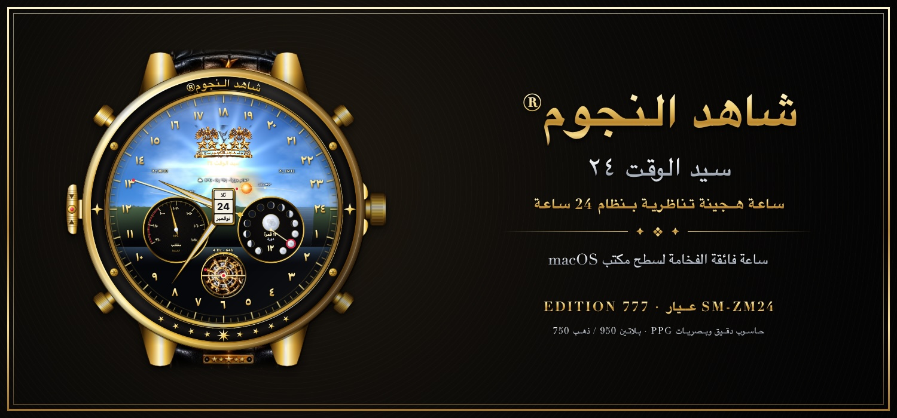
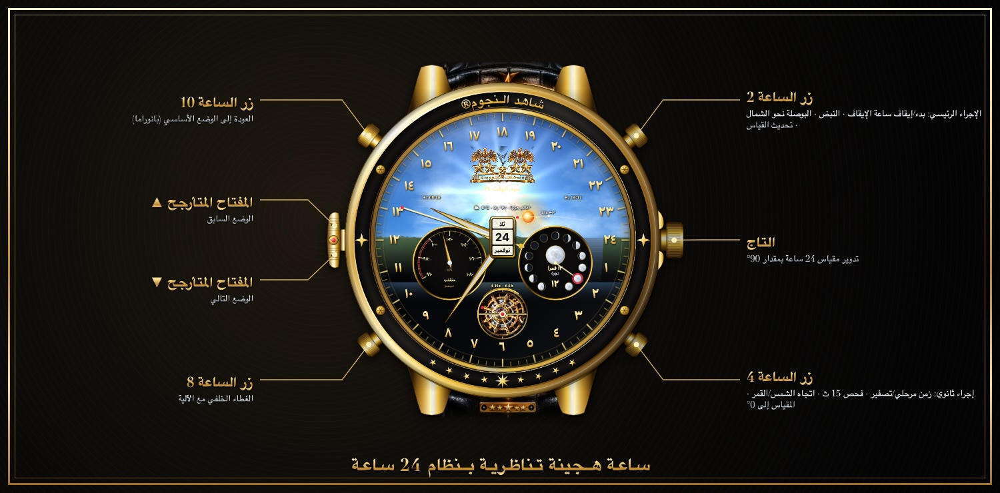
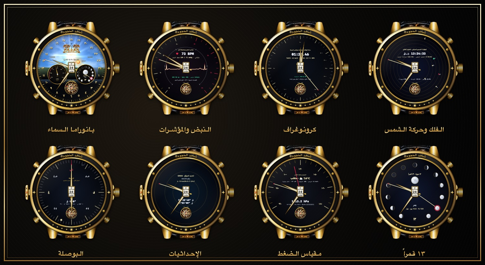
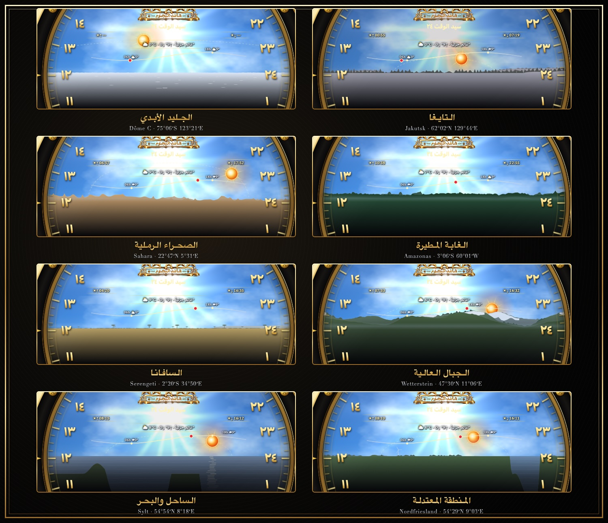
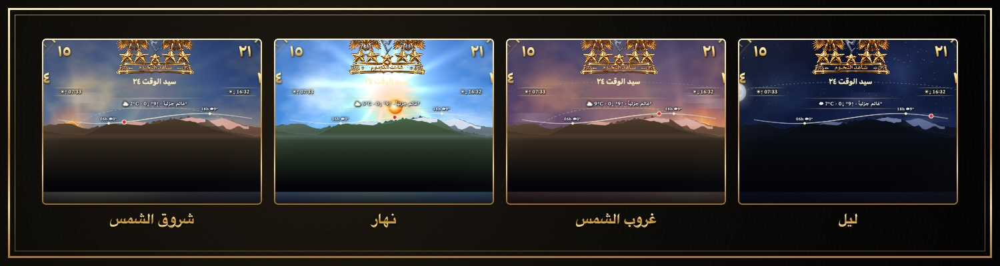
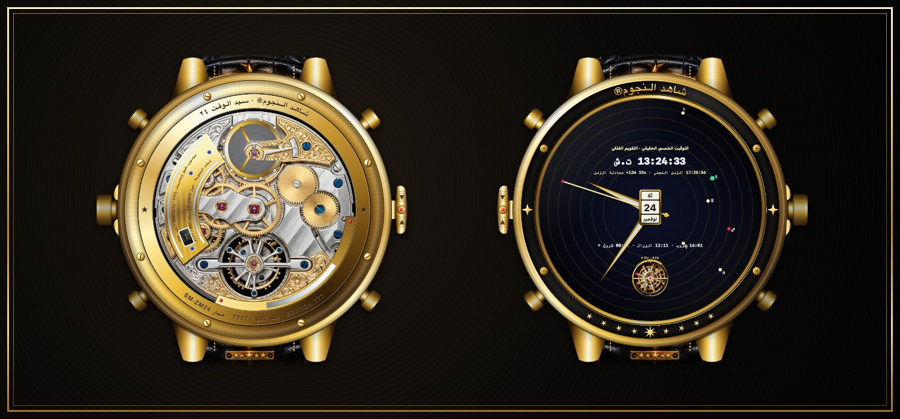

  

<a href="README.md">🇩🇪 Deutsch</a> &nbsp;·&nbsp; <a href="README.en.md">🇬🇧 English</a> &nbsp;·&nbsp; <a href="README.fr.md">🇫🇷 Français</a> &nbsp;·&nbsp; <a href="README.ru.md">🇷🇺 Русский</a> &nbsp;·&nbsp; <a href="README.zh.md">🇨🇳 中文</a> &nbsp;·&nbsp; <b>🇦🇪 العربية</b> &nbsp;·&nbsp; <a href="README.he.md">🇮🇱 עברית</a> &nbsp;·&nbsp; <a href="README.yi.md">📜 Yiddish</a> &nbsp;·&nbsp; <a href="README.nl.md">🇳🇱 Nederlands</a>

<h1 align="center">✦ شاهد النجوم® سيد الوقت ٢٤ ✦</h1>
<h3 align="center"><i>ساعة هجينة تناظرية بنظام 24 ساعة</i> · ساعة فائقة الفخامة لسطح مكتب macOS</h3>

  
  
  
  

<b>أكثر من مجرد وقت. كونٌ على مكتبك.</b> فخامة فائقة · دقة · تقاليد · مستقبل

## ✦ الساعة الهجينة التناظرية بنظام 24 ساعة

تجمع **سيد الوقت ٢٤** بين هدوء آلية العقارب الكلاسيكية وذكاء الأداة الدقيقة. يقسم مينائها اليوم إلى **24 ساعة** – الساعة 18 في الأعلى، والسادسة في الأسفل، والظهيرة يسارًا، ومنتصف الليل يمينًا – وخلفه سماء حيّة: تعبر الشمس والقمر الأفق في **موقعهما الحقيقي**، والمشهد في الأسفل هو مشهد **موقعك أنت**.

<table align="center">
<tr><td><b>✦ العلبة</b></td><td>ذهب عيار 18 مصقول، إطار من الجزع، اسم العلامة محفور</td></tr>
<tr><td><b>✦ العيار</b></td><td>SM-ZM24 · توربيون فوق الرقم 6 · 4 هرتز · مؤشر احتياطي الطاقة</td></tr>
<tr><td><b>✦ التحكم</b></td><td>تاج وأربعة أزرار ومفتاح متأرجح</td></tr>
<tr><td><b>✦ الإصدارات</b></td><td>9 لغات بأرقامها وشعاراتها ونقوشها الخاصة</td></tr>
<tr><td><b>✦ النظام</b></td><td>macOS 14 Sonoma أو أحدث · Apple Silicon و Intel</td></tr>
</table>

## ✦ التحكم – التنقل يسارًا، والتنفيذ يمينًا

لكل عنصر تحكم مهمة واحدة فقط. الجانب الأيسر يرشدك عبر الساعة، والجانب الأيمن ينفّذ داخل الوضع المختار.

| العنصر | الوظيفة |
|:--|:--|
| **▲ ▼ المفتاح المتأرجح · الساعة 9** | الوضع السابق أو التالي – التعقيدات الثمانية في دائرة |
| **زر · الساعة 10** | العودة إلى الوضع الأساسي (بانوراما) |
| **زر · الساعة 8** | الغطاء الخلفي مع الآلية |
| **التاج · الساعة 3** | تدوير مقياس 24 ساعة بمقدار 90° |
| **زر · الساعة 2** | الإجراء الرئيسي: بدء/إيقاف ساعة الإيقاف · النبض · البوصلة نحو الشمال · تحديث القياس |
| **زر · الساعة 4** | إجراء ثانوي: زمن مرحلي/تصفير · فحص 15 ث · اتجاه الشمس/القمر · المقياس إلى 0° |

## ✦ ثماني تعقيدات

| | |
|:--|:--|
| **1 · بانوراما السماء** | سماء 24 ساعة مع الشمس والقمر والطقس والبارومتر ومؤشر الأقمار الثلاثة عشر والتوربيون. |
| **2 · النبض والمؤشرات** | مقياس النبض وضغط الدم وتغيّر نبض القلب وتشبع الأكسجين ومنحنى نبض حي؛ قياس النبض بالنقر. |
| **3 · ساعة الإيقاف** | راترابانت حتى 1/100 ثانية مع أزمنة مرحلية ومقياس سرعة ومقياس نبض. |
| **4 · الكون والشمس** | التوقيت الشمسي الحقيقي ومعادلة الزمن والزمن النجمي وحركة الكواكب. |
| **5 · البوصلة** | تتجه الإبرة بثبات إلى الشمال وتتأرجح بتخميد عند تغيّر الاتجاه؛ اتجاه الشمس والقمر. |
| **6 · الإحداثيات** | خط العرض وخط الطول بالدرجات والدقائق والثواني، مع الارتفاع ومصدر الموقع. |
| **7 · البارومتر** | ضغط الهواء 960–1080 هكتوباسكال مع الطقس والحرارة والرطوبة والرياح. |
| **8 · 13 قمرًا** | الدورة القمرية للسنة مع الطور والإضاءة وعمر القمر. |

## ✦ مشهد موقعك

بدلًا من بانوراما جبلية مرسومة، يعرض الأفق **التضاريس الحقيقية** حولك: بيانات الارتفاع على مسافات 2 و5 و12 و30 كم في 24 اتجاهًا، والبحر من خدمة الموقع لدى Apple أو MapKit، والمنطقة المناخية وفق تصنيف كوبن-غايغر من بيانات ثلاث سنوات. أينما كنت على الأرض يظهر المشهد المناسب – من **الجليد الأبدي** مرورًا بالتندرا والتايغا والصحراء والسافانا وحتى **الغابة المطيرة**، مع البحر والجليد البحري والثلج فوق خط الثلوج.

## ✦ الشمس والقمر في الوقت الحقيقي

تقف الشمس والقمر في موقعهما المحسوب في السماء ويقطعان قوسهما بسرعة طبيعية. أوقات الشروق والغروب دقيقة حتى الدقيقة، ويُتعرّف على النهار القطبي والليل القطبي. تتبع السماء الارتفاع الحقيقي للشمس من الفجر إلى النهار ثم الغسق والليل.

## ✦ الغطاء الخلفي والكون

يكشف زر الساعة 8 عن الآلية: بلاتين 950 وذهب 750 مع الياقوت والبراغي المزرقة. ويعرض وضع الكون التوقيت الشمسي الحقيقي ومعادلة الزمن والزمن النجمي وحركة الكواكب. الآلية حيّة: يتأرجح الميزان بتردد 4 هرتز فوق نابض بريغيه المتنفّس، ويدور قفص التوربيون دورة كل 60 ثانية، وتتعاشق التروس. **دوّار طرفي** من ذهب عيار 22 بكتلة من البلاتين 950 يعبّئ الساعة تلقائيًا عند حافة الآلية دون أن يحجب الرؤية. وتغطي لوحة ذهبية منقوشة بتموجات جنيف ومطعّمة بالبلاتين ونافذة من الياقوت الحاسوبَ الدقيق. وعند قلبها تُظهر الساعة كامل سماكة علبتها.

## ✦ تسعة إصدارات

يحمل كل إصدار اسم علامته محفورًا على حافة العلبة ويتحدث لغته حتى أدق التفاصيل – الميناء والأرقام والمقاييس والقوائم والنقوش.

| الإصدار | اسم العلامة | الأرقام |
|:--|:--|:--|
| 🇩🇪 Deutsch | **SternenMeister®** · Zeitmeister 24 | 1 – 24 |
| 🇬🇧 English | **StarMaster®** · TimeMaster 24 | 1 – 24 |
| 🇫🇷 Français | **Maître des Étoiles®** · Maître du Temps 24 | 1 – 24 |
| 🇷🇺 Русский | **Звёздный Мастер®** · Мастер Времени 24 | 1 – 24 |
| 🇨🇳 中文 | **大师®** · 时空大师 24 | 一 – 二十四 |
| 🇦🇪 العربية | **شاهد النجوم®** · سيد الوقت ٢٤ | ١ – ٢٤ |
| 🇮🇱 עברית | **שטערן מייסטער®** · מאסטר הזמן 24 | א׳ – כ״ד |
| 📜 Yiddish | **ShternMayster®** · Tseytmayster 24 | 1 – 24 |
| 🇳🇱 Nederlands | **SterrenMeester®** · Tijdmeester 24 | 1 – 24 |

## ✦ التثبيت والتحديثات

1. نزّل [`Zeitmeister24-Widget-macOS.zip`](https://github.com/SonnerStudio/SternenMeister-ZeitMeister24-Widget/releases/latest/download/Zeitmeister24-Widget-macOS.zip) وفك ضغطه.
2. اسحب `ZeitmeisterApp.app` إلى مجلد **التطبيقات** وافتحه.
3. يفحص مركز التحديث (قائمة **Update**) GitHub فور فتحه ويثبّت الإصدارات الجديدة بنقرة واحدة.

> التطبيق موقَّع حاليًا توقيعًا مؤقتًا. عند الفتح الأول قد يعرض macOS تنبيهًا: انقر بزر الفأرة الأيمن على التطبيق ← **فتح**.

## ✦ مصادر البيانات والخصوصية

للطقس وضغط الهواء ومسار الشمس والقمر والمشهد، يُرسَل **موقعك التقريبي** إلى [Open-Meteo](https://open-meteo.com) (الطقس ونموذج الارتفاع وأرشيف المناخ) وإلى خدمة الموقع لدى Apple. يطلب macOS إذن الموقع؛ ومن دونه تعمل الساعة وفق المنطقة الزمنية وتعرض أرضًا مفتوحة.

## ✦ الجديد في الإصدار 2.8.2

- ✦ علبة جديدة كليًا مرسومة مع نقش اسم علامة الإصدار على الحافة
- ✦ مفتاح متأرجح عند الساعة 9 ومنطق تحكم جديد: التنقل يسارًا والتنفيذ يمينًا
- ✦ ميناء مترجم بالكامل في كل الأوضاع، وأرقام أصلية للعبرية والصينية والعربية
- ✦ مشهد حسب الموقع، ومسار حقيقي للشمس والقمر، ونهار وليل قطبيان
- ✦ تستقر العقارب خلال 0.9 ثانية عند كل تبديل وكل دوران بزاوية 90°

© 2026 SonnerStudio · مصنع شاهد النجوم® · الإصدار 777 · جميع الحقوق محفوظة.

