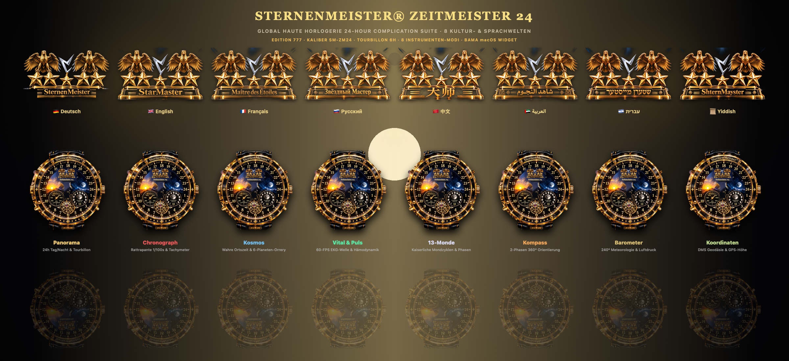

# شاهد النجوم® سيد الوقت ٢٤ — أداة سطح المكتب لنظام ماك (`v2.7.0`)

🌐 **Sprache wählen / Select Language / Choisissez la langue / Выберите язык / 选择语言 / اختر اللغة / בחר שפה:**

[🇩🇪 Deutsch](README.md) • [🇬🇧 English](README.en.md) • [🇫🇷 Français](README.fr.md) • [🇷🇺 Русский](README.ru.md) • [🇨🇳 中文](README.zh.md) • [🇦🇪 العربية](README.ar.md) • [🇮🇱 עברית](README.he.md) • [📜 Jiddisch](README.yi.md)

---

الإصدار الرسمي الثنائي فائق الفخامة لأداة سطح المكتب **شاهد النجوم® سيد الوقت ٢٤** لأجهزة ماك (macOS 14 Sonoma والإصدارات الأحدث).

---

## ✨ الجديد في الإصدار `2.5.0`: الإصدار العالمي الفاخر

### 1. ٨ عوالم ثقافية ولغوية متكاملة على الميناء
التبديل الفوري بين ٨ تقاليد فلكية وساعاتية عالمية — بما في ذلك **الشعار الملكي الذهبي المصنوع يدويًا مع رمز البلاتين**، وأرقام الميناء المخصصة، ونافذة التقويم عند الساعة ٦، ودعم اتجاه القراءة من اليمين إلى اليسار (RTL):
- **🇦🇪 العربية (شاهد النجوم):** الأرقام المشرقية العربية `١..٢٤`، `هكتوباسكال · الضغط الجوي`، `دورة ١٣ قمراً`.
- **🇩🇪 الألمانية (SternenMeister):** سماء جبال الألب، `hPa · LUFTDRUCK`، `13-MONDE ZYKLUS`.
- **🇬🇧 الإنجليزية (StarMaster):** الأرقام الرومانية، `hPa · PRESSURE`، `13-MOONS CYCLE`.
- **🇫🇷 الفرنسية (Maître des Étoiles):** خطوط ديدو الراقية، `hPa · PRESSION`، `CYCLE DES 13 LUNES`.
- **🇷🇺 الروسية (Звёздный Мастер):** الخط الإمبراطوري، `гПа · ДАВЛЕНИЕ`، `13-ЛУННЫЙ ЦИКЛ`.
- **🇨🇳 الصينية (大师 · 时空大师):** الأرقام الذهبية الإمبراطورية `一..二十四`، `百帕 · 气压`، `十三月相周期`.
- **🇮🇱 العبرية (שטערן מייסטער):** الأرقام العبرية الأصيلة `א׳..כ״ד`، `hPa · לחץ ברומטרי`، دعم RTL كامل.
- **📜 اليديشية (ShternMayster):** الحروف اللاتينية على مدار ٢٤ ساعة، `hPa · LUFTDRUK`.

### 2. تلميحات توضيحية شاملة في القائمة
تم تزويد كل عنصر من عناصر القائمة وجميع الأنماط التشغيلية **بتلميحات ذكية وشروحات موجزة** لشرح الوظائف والآليات بدقة وسلاسة.

### 3. الأنماط التشغيلية الفلكية الثمانية
1. **نمط بانوراما السماء:** قبة سماوية متصلة على مدار ٢٤ ساعة مع شمس واقعية ثلاثية الأبعاد، وتوربيون متحرك عند الساعة ٦ (عيار SM-ZM24).
2. **نمط الكرونوغراف:** ساعة توقيت مزدوجة العقارب بدقة ١/١٠٠ ثانية، مقياس سرعة تاكيميتر ومقياس نبض طبي.
3. **الفلك وحركة الشمس:** التوقيت الشمسي الحقيقي (WOZ)، معادلة الوقت الفلكية (EoT)، ومجسم الكواكب الستة.
4. **النبض والمؤشرات الحيوية:** راسم إشارة النبض والقلب ٦٠ إطار/ثانية، قياس ضغط الدم والأكسجين SpO2.
5. **دورة ١٣ قمراً:** دورة فلكية قمرية ١٣×٢٨ يوماً وفق معيار ADR-0008.
6. **نمط البوصلة:** توجيه فلكي دقيق ٣٦٠ درجة نحو الشمال عبر عقرب الثواني المرصع بالياقوت.
7. **مقياس الضغط الجوي:** مقياس بارومتري واسع ٢٤٠ درجة (٩٦٠–١٠٨٠ هكتوباسكال) مع ربط Open-Meteo.
8. **نمط الإحداثيات:** تحديد جغرافي دقيق بنظام الدرجات والدقائق والثواني (`° ' "`) والارتفاع عن سطح البحر.

---

## 📦 التثبيت والتحديث التلقائي

1. قم بتنزيل ملف [`Zeitmeister24-Widget-macOS.zip`](https://github.com/SonnerStudio/SternenMeister-ZeitMeister24-Widget/releases/latest/download/Zeitmeister24-Widget-macOS.zip) وفك ضغطه.
2. انقل تطبيق `ZeitmeisterApp.app` إلى مجلد `/Applications`.
3. التحديث التلقائي مدمج ومباشر عبر خوادم جيت هاب.

---

*© 2026 SonnerStudio · دار ساعات شاهد النجوم® · الإصدار ٧٧٧ · جميع الحقوق محفوظة.*
