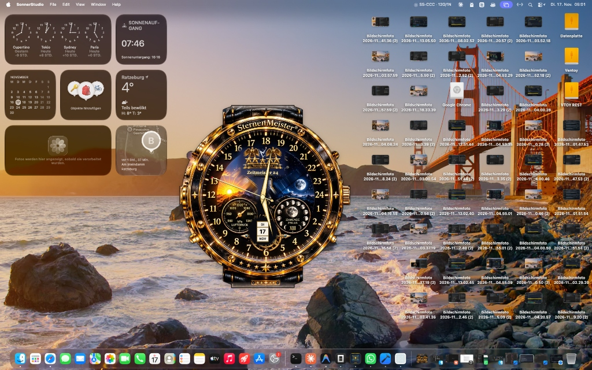

# SternenMeister Zeitmeister 24 · macOS Desktop Widget

[🇩🇪 Auf Deutsch lesen](README.md) · 🇬🇧 **English**

---

  
   
  <em>SternenMeister Zeitmeister 24 · Edition 777 (Live macOS Desktop Widget · v2.1.0)</em>

## Overview
The **SternenMeister Zeitmeister 24 Desktop Widget** brings the hyper-luxury timepiece as a live interactive functional model directly to your macOS desktop — freely draggable, resizable from `2×2` to `10×10`, and operated directly via its 6 side case pushers.

  

### Features & Complications (v2.1.0):
- **24-Hour Dial (90° Rotatable):** 1 revolution in 24 hours (`18:00` top, `24:00` right, `06:00` bottom, `12:00` left). Click the main crown or menu to rotate in `90°` increments (`0° / 90° / 180° / 270°`) in photorealistic luxury quality.
- **Mechanical Hands & Central Date Housing:** 18k yellow gold hour and minute hands with platinum inlay, classic v1.0 gold second hand with red tip, center-axle mounted mechanical date housing (`Weekday / Day / Month`), and visible golden 6-o'clock tourbillon.
- **AAA Electronic Multifunction Display (5 Modes via Clickable Side Pushers):**
  - **Panorama:** Dynamic 24-hour day/night sky progression (sunrise, day, golden hour, starry Milky Way night with moving sun arc) and original SternenMeister Platinum-Vril crest.
  - **Precision Compass:** Home alignment (hour hand to 6:00, minute & red-tip second hand to 12:00) transitioning dynamically to live North over a 360° compass rose.
  - **GNSS & Coordinates:** Live macOS Location Services (`CoreLocation`) coordinates (`DMS`), elevation, and timezone with automatic timezone fallback.
  - **Live Barometer:** Real-time atmospheric pressure (`hPa`) via Open-Meteo API with classic **1-word weather condition** (`STURM` / `REGEN` / `WECHSEL` / `SCHÖN` / `BESTÄNDIG`).
  - **13-Moons Annual Display:** All 13 moons of the year with a precision **red-ring pointer** framing the current moon of the year and live Roman numeral (`I`–`XIII` or `✦`).
- **AAA Caseback View (Sapphire Exhibition Back):** Toggle via right-click or left side pusher to inspect the ultra-luxury Platinum 950 & 24k Gold Haute-Horlogerie caliber (`SM-ZM24`) with 4 Hz balance sheen, skeletonized 22k gold rotor, sapphire crystal, and engraved 18k gold microcomputer access plate.
- **High-Gloss Burled Walnut Collector's Box (`Edition 777 · No. 007 / 7777`):** Toggle between standalone watch and borderless piano-lacquer collector's box with 3D-angled live watch on stitched black calfskin cushion.
- **GitHub Auto-Updater:** Checks every 30 minutes (`version.json` + GitHub Releases) with gold ⬇︎ badge, code-signature verification, and one-click installation.

---

## Installation
1. Download the latest release from [GitHub Releases](https://github.com/SonnerStudio/SternenMeister-ZeitMeister24-Widget/releases/latest).
2. Unpack the ZIP and double-click `install-widget.command`.
3. The widget installs to `/Applications` and launches automatically.

---

## License & Copyright
Copyright © 2026 SonnerStudio. All rights reserved. Proprietary closed-source binary distribution. See [LICENSE.md](LICENSE.md) for details.
