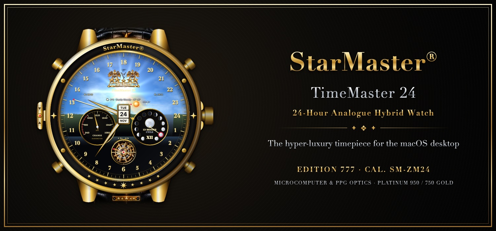
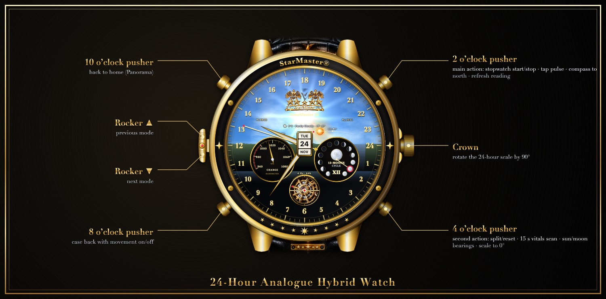
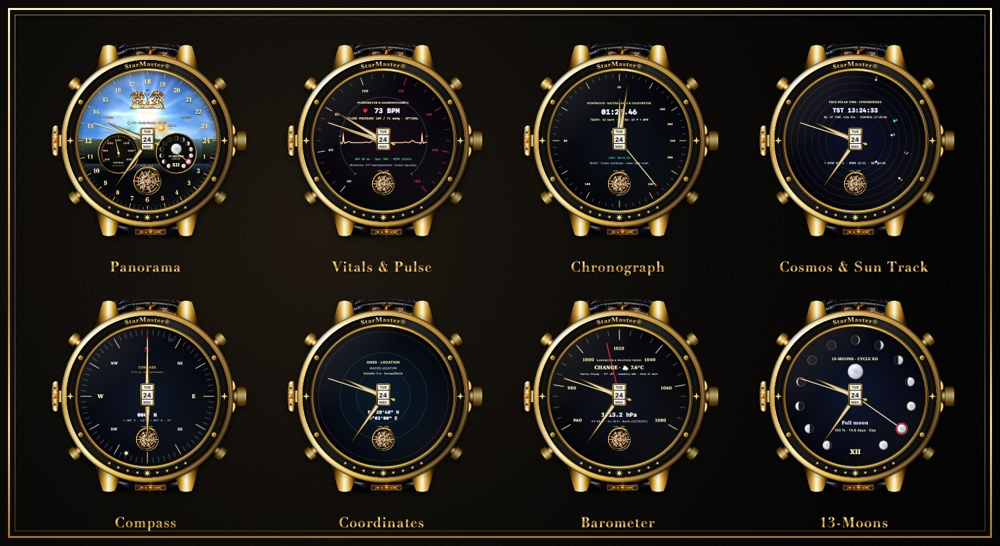
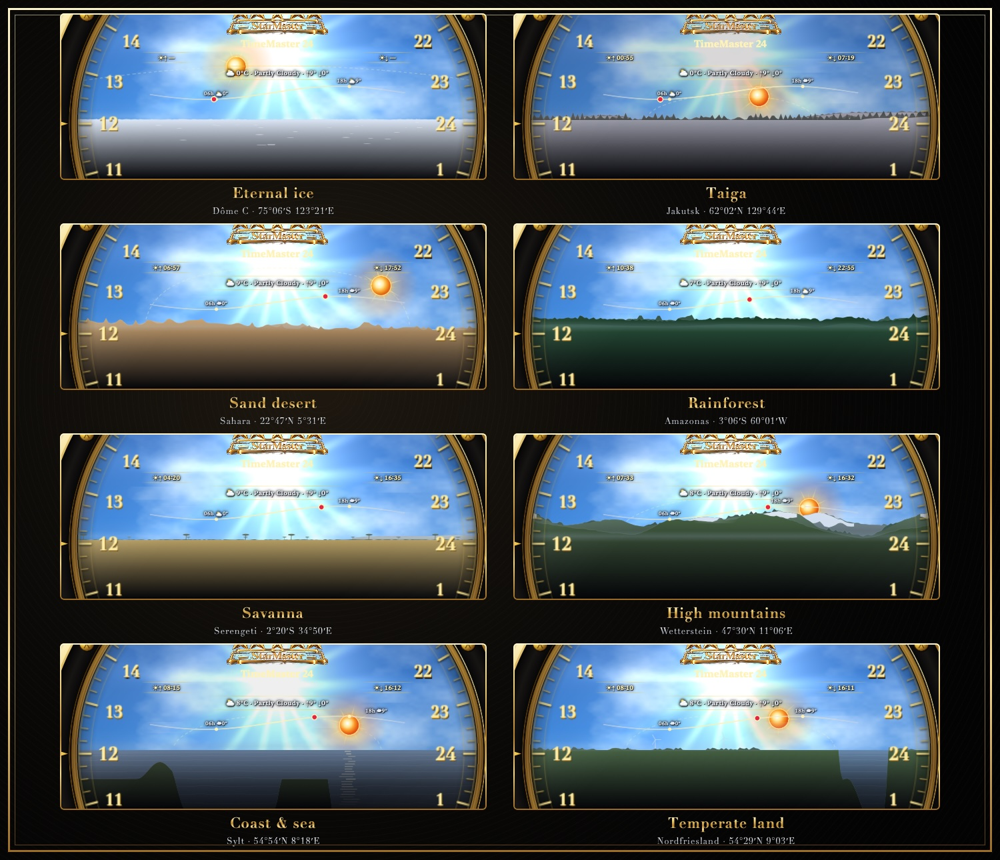
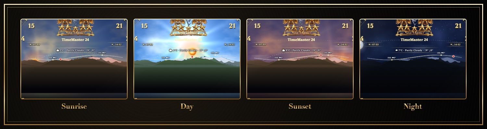
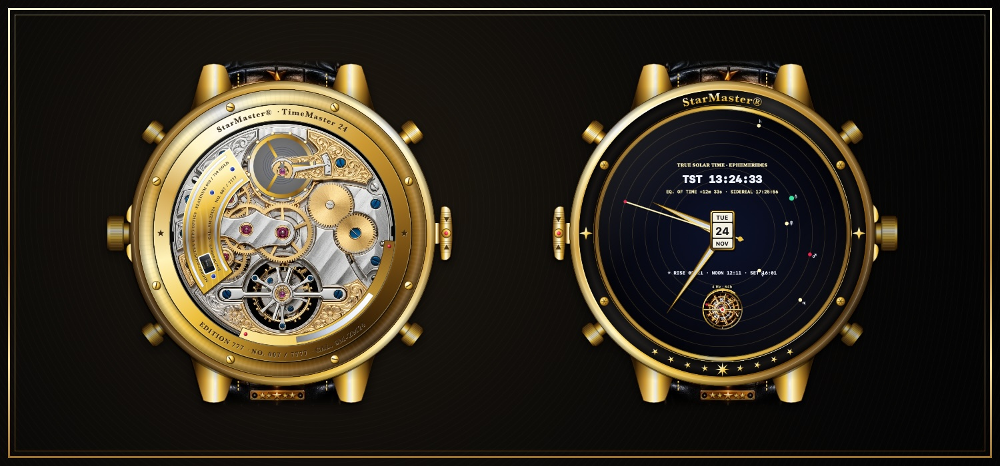

  

<a href="README.md">🇩🇪 Deutsch</a> &nbsp;·&nbsp; <b>🇬🇧 English</b> &nbsp;·&nbsp; <a href="README.fr.md">🇫🇷 Français</a> &nbsp;·&nbsp; <a href="README.ru.md">🇷🇺 Русский</a> &nbsp;·&nbsp; <a href="README.zh.md">🇨🇳 中文</a> &nbsp;·&nbsp; <a href="README.ar.md">🇦🇪 العربية</a> &nbsp;·&nbsp; <a href="README.he.md">🇮🇱 עברית</a> &nbsp;·&nbsp; <a href="README.yi.md">📜 Yiddish</a> &nbsp;·&nbsp; <a href="README.nl.md">🇳🇱 Nederlands</a>

<h1 align="center">✦ StarMaster® TimeMaster 24 ✦</h1>
<h3 align="center"><i>24-Hour Analogue Hybrid Watch</i> · The hyper-luxury timepiece for the macOS desktop</h3>

  
  
  
  

<b>More than time. A universe on your desk.</b> HYPER-LUXURY · PRECISION · TRADITION · FUTURE

## ✦ The 24-Hour Analogue Hybrid

The **TimeMaster 24** unites the calm of a classic hand-driven movement with the intelligence of an instrument. Its dial divides the day into **24 hours** – 18:00 at the top, 06:00 at the bottom, noon on the left, midnight on the right – and shows a living sky behind it: sun and moon cross the horizon at their **true position**, and the landscape below is the landscape of **your location**.

<table align="center">
<tr><td><b>✦ Case</b></td><td>Polished 18-carat gold, onyx bezel, engraved brand name</td></tr>
<tr><td><b>✦ Calibre</b></td><td>SM-ZM24 · tourbillon above 6 · 4 Hz · power-reserve indicator</td></tr>
<tr><td><b>✦ Controls</b></td><td>Crown, four pushers and a rocker</td></tr>
<tr><td><b>✦ Editions</b></td><td>9 languages with their own numerals, crests and engravings</td></tr>
<tr><td><b>✦ System</b></td><td>macOS 14 Sonoma or later · Apple silicon & Intel</td></tr>
</table>

## ✦ Controls – navigate on the left, act on the right

Every control has exactly one task. The left side guides you through the watch, the right side acts within the selected mode.

| Control | Function |
|:--|:--|
| **▲ ▼ Rocker · 9 o’clock** | Previous or next mode – all eight complications in a loop |
| **Pusher · 10 o’clock** | Back to home (Panorama) |
| **Pusher · 8 o’clock** | Case back with movement on/off |
| **Crown · 3 o’clock** | Rotate the 24-hour scale by 90° |
| **Pusher · 2 o’clock** | Main action: stopwatch start/stop · tap pulse · compass to north · refresh reading |
| **Pusher · 4 o’clock** | Second action: split/reset · 15 s vitals scan · sun/moon bearings · scale to 0° |

## ✦ Eight complications

| | |
|:--|:--|
| **1 · Panorama** | 24-hour sky with sun, moon, weather, barometer, 13-moons display and tourbillon. |
| **2 · Vitals & Pulse** | Pulsometer, blood pressure, HRV, SpO₂ and live pulse curve; measure your pulse by tapping. |
| **3 · Stopwatch** | Rattrapante to 1/100 s with split times, tachymeter and pulsometer. |
| **4 · Cosmos & Sun** | True solar time, equation of time, sidereal time and planetary motion. |
| **5 · Compass** | Needle moves rigidly to north, swings damped on a change of direction; sun and moon bearings. |
| **6 · Coordinates** | Latitude and longitude in degrees, minutes, seconds, altitude and location source. |
| **7 · Barometer** | Air pressure 960–1080 hPa with weather, temperature, humidity and wind. |
| **8 · 13 Moons** | The lunar cycle of the year with phase, illumination and moon age. |

## ✦ The landscape of your location

Instead of a painted mountain panorama, the horizon shows the **real terrain** around you: elevation data at 2, 5, 12 and 30 km in 24 directions, the sea from Apple’s location service or MapKit, and the Köppen-Geiger climate zone from three years of weather data. Wherever you are on Earth, the right scene appears – from **eternal ice** through tundra, taiga, desert and savanna to the **rainforest**, with sea, sea ice and snow above the snow line.

## ✦ Sun and moon in real time

Sun and moon stand at their computed position in the sky and travel their arc at natural speed. Rise and set times are accurate to the minute; midnight sun and polar night are recognised. The sky follows the true solar altitude from dawn through day to dusk and night.

## ✦ Case back & cosmos

The 8 o’clock pusher reveals the movement: platinum 950 and gold 750 with rubies and blued screws. The Cosmos mode shows true solar time, equation of time, sidereal time and the motion of the planets. The movement is alive: the balance swings at 4 Hz above its breathing Breguet hairspring, the tourbillon cage turns once every 60 seconds and the gear train meshes. A **peripheral rotor** in 22-carat gold with a platinum 950 weight winds the watch around the rim of the movement without blocking the view. An engraved gold plate with Côtes de Genève, platinum inlays and a sapphire window covers the microcomputer. When turned over, the watch shows its full case depth.

## ✦ Nine editions

Each edition carries its brand name engraved on the case rim and speaks its language down to the last detail – dial, numerals, scales, menus and engravings.

| Edition | Brand name | Numerals |
|:--|:--|:--|
| 🇩🇪 Deutsch | **SternenMeister®** · Zeitmeister 24 | 1 – 24 |
| 🇬🇧 English | **StarMaster®** · TimeMaster 24 | 1 – 24 |
| 🇫🇷 Français | **Maître des Étoiles®** · Maître du Temps 24 | 1 – 24 |
| 🇷🇺 Русский | **Звёздный Мастер®** · Мастер Времени 24 | 1 – 24 |
| 🇨🇳 中文 | **大师®** · 时空大师 24 | 一 – 二十四 |
| 🇦🇪 العربية | **شاهد النجوم®** · سيد الوقت ٢٤ | ١ – ٢٤ |
| 🇮🇱 עברית | **שטערן מייסטער®** · מאסטר הזמן 24 | א׳ – כ״ד |
| 📜 Yiddish | **ShternMayster®** · Tseytmayster 24 | 1 – 24 |
| 🇳🇱 Nederlands | **SterrenMeester®** · Tijdmeester 24 | 1 – 24 |

## ✦ Installation & updates

1. Download [`Zeitmeister24-Widget-macOS.zip`](https://github.com/SonnerStudio/SternenMeister-ZeitMeister24-Widget/releases/latest/download/Zeitmeister24-Widget-macOS.zip) and unzip it.
2. Drag `ZeitmeisterApp.app` into **Applications** and open it.
3. The update centre (menu **Update**) checks GitHub as soon as it opens and installs new versions with one click.

> The app is currently ad-hoc signed. On first launch macOS may show a notice: right-click the app → **Open**.

## ✦ Data sources & privacy

For weather, air pressure, the paths of sun and moon and the landscape, your **approximate location** is sent to [Open-Meteo](https://open-meteo.com) (weather, elevation model, climate archive) and to Apple’s location service. macOS asks for location access. Without it the watch uses your time zone and shows open land.

## ✦ New in version 2.8.2

- ✦ Completely new, drawn case with the edition’s brand engraved on the rim
- ✦ Rocker at 9 o’clock and new control logic: navigate on the left, act on the right
- ✦ Dial fully translated in every mode, native number scripts for Hebrew, Chinese and Arabic
- ✦ Landscape for your location, true sun and moon paths, midnight sun and polar night
- ✦ Hands settle in 0.9 s on every change and every 90° rotation

© 2026 SonnerStudio · StarMaster® Manufacture · Edition 777 · All rights reserved.

