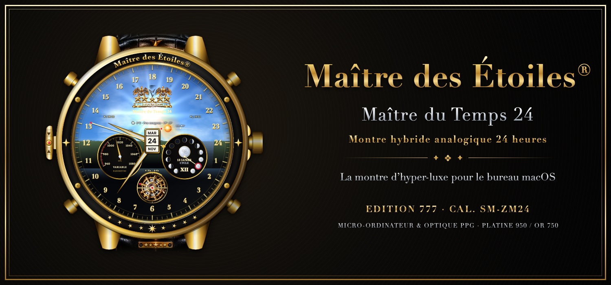
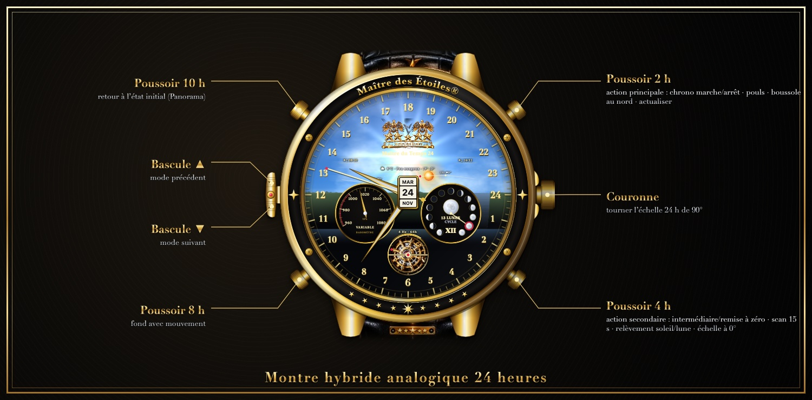
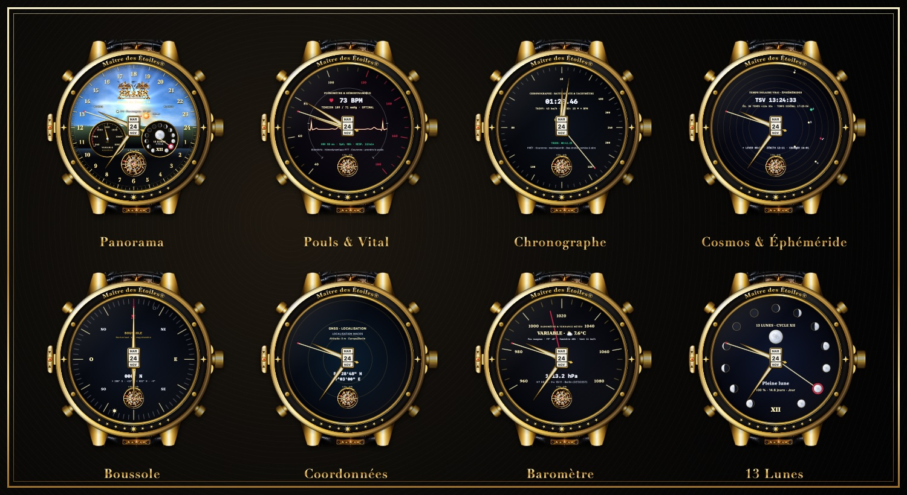
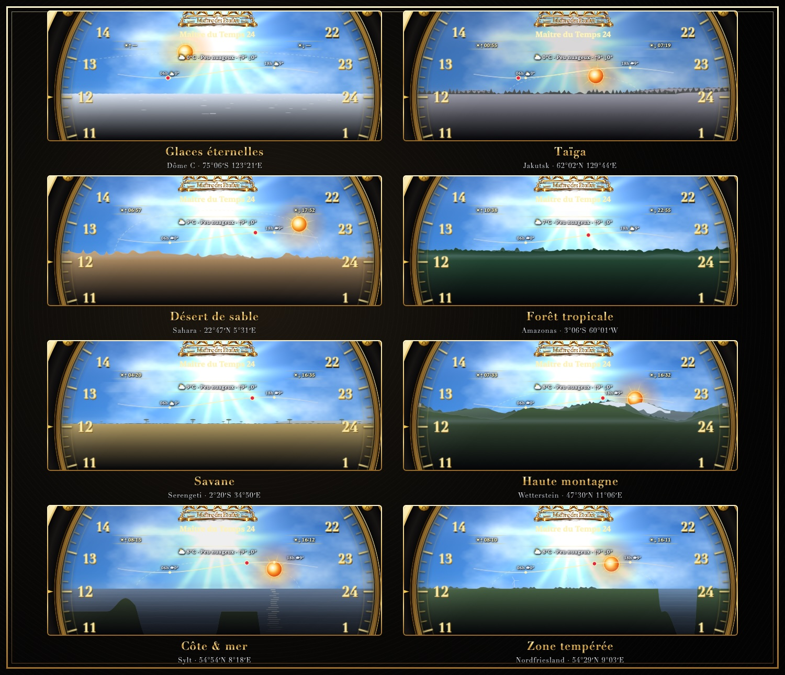
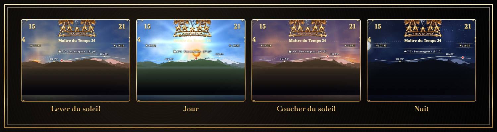
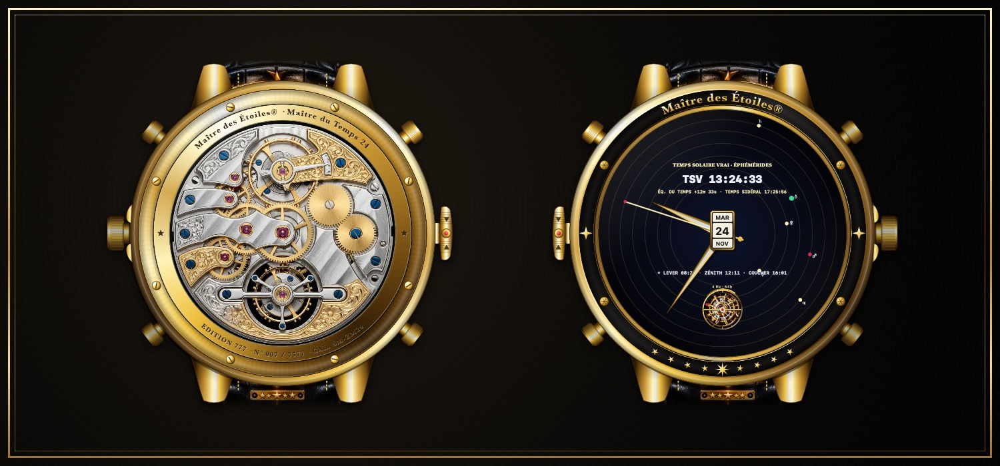

  

<a href="README.md">🇩🇪 Deutsch</a> &nbsp;·&nbsp; <a href="README.en.md">🇬🇧 English</a> &nbsp;·&nbsp; <b>🇫🇷 Français</b> &nbsp;·&nbsp; <a href="README.ru.md">🇷🇺 Русский</a> &nbsp;·&nbsp; <a href="README.zh.md">🇨🇳 中文</a> &nbsp;·&nbsp; <a href="README.ar.md">🇦🇪 العربية</a> &nbsp;·&nbsp; <a href="README.he.md">🇮🇱 עברית</a> &nbsp;·&nbsp; <a href="README.yi.md">📜 Yiddish</a> &nbsp;·&nbsp; <a href="README.nl.md">🇳🇱 Nederlands</a>

<h1 align="center">✦ Maître des Étoiles® Maître du Temps 24 ✦</h1>
<h3 align="center"><i>Montre hybride analogique 24 heures</i> · La montre d’hyper-luxe pour le bureau macOS</h3>

  
  
  
  

<b>Plus que le temps. Un univers sur votre bureau.</b> HYPER-LUXE · PRÉCISION · TRADITION · AVENIR

## ✦ La montre hybride analogique 24 heures

Le **Maître du Temps 24** unit la sérénité d’un mouvement à aiguilles classique à l’intelligence d’un instrument. Son cadran divise la journée en **24 heures** – 18 h en haut, 6 h en bas, midi à gauche, minuit à droite – et révèle un ciel vivant : le soleil et la lune traversent l’horizon à leur **position réelle**, et le paysage en dessous est celui de **votre lieu**.

<table align="center">
<tr><td><b>✦ Boîte</b></td><td>Or 18 carats poli, lunette en onyx, nom de marque gravé</td></tr>
<tr><td><b>✦ Calibre</b></td><td>SM-ZM24 · tourbillon au-dessus du 6 · 4 Hz · indicateur de réserve de marche</td></tr>
<tr><td><b>✦ Commandes</b></td><td>Couronne, quatre poussoirs et une bascule</td></tr>
<tr><td><b>✦ Éditions</b></td><td>9 langues avec leurs propres chiffres, armoiries et gravures</td></tr>
<tr><td><b>✦ Système</b></td><td>macOS 14 Sonoma ou plus récent · Apple silicon & Intel</td></tr>
</table>

## ✦ Commandes – naviguer à gauche, agir à droite

Chaque commande a une seule fonction. Le côté gauche guide à travers la montre, le côté droit agit dans le mode choisi.

| Commande | Fonction |
|:--|:--|
| **▲ ▼ Bascule · 9 h** | Mode précédent ou suivant – les huit complications en boucle |
| **Poussoir · 10 h** | Retour à l’état initial (Panorama) |
| **Poussoir · 8 h** | Fond avec mouvement |
| **Couronne · 3 h** | Tourner l’échelle 24 h de 90° |
| **Poussoir · 2 h** | Action principale : chrono marche/arrêt · pouls · boussole au nord · actualiser |
| **Poussoir · 4 h** | Action secondaire : intermédiaire/remise à zéro · scan 15 s · relèvement soleil/lune · échelle à 0° |

## ✦ Huit complications

| | |
|:--|:--|
| **1 · Panorama** | Ciel de 24 heures avec soleil, lune, météo, baromètre, affichage des 13 lunes et tourbillon. |
| **2 · Pouls & vital** | Pulsomètre, tension, VFC, SpO₂ et courbe du pouls en direct ; prise du pouls par tapotement. |
| **3 · Chronographe** | Rattrapante au 1/100 s avec temps intermédiaires, tachymètre et pulsomètre. |
| **4 · Cosmos & soleil** | Temps solaire vrai, équation du temps, temps sidéral et course des planètes. |
| **5 · Boussole** | L’aiguille rejoint le nord sans à-coup puis oscille amortie à chaque changement de cap ; relèvement du soleil et de la lune. |
| **6 · Coordonnées** | Latitude et longitude en degrés, minutes, secondes, altitude et source de localisation. |
| **7 · Baromètre** | Pression 960–1080 hPa avec temps, température, humidité et vent. |
| **8 · 13 Lunes** | Le cycle lunaire de l’année avec phase, éclairement et âge de la lune. |

## ✦ Le paysage de votre lieu

Au lieu d’un panorama de montagnes peint, l’horizon montre le **relief réel** autour de vous : altitudes à 2, 5, 12 et 30 km dans 24 directions, la mer via le service de localisation d’Apple ou MapKit, et la zone climatique de Köppen-Geiger issue de trois années de données. Partout sur Terre apparaît le bon décor – des **glaces éternelles** à la toundra, la taïga, le désert et la savane jusqu’à la **forêt tropicale**, avec mer, banquise et neige au-dessus de la limite des neiges.

## ✦ Soleil et lune en temps réel

Le soleil et la lune occupent leur position calculée et parcourent leur arc à vitesse naturelle. Les heures de lever et de coucher sont exactes à la minute ; jour polaire et nuit polaire sont reconnus. Le ciel suit la hauteur réelle du soleil, de l’aube au jour, au crépuscule et à la nuit.

## ✦ Fond de boîte & cosmos

Le poussoir de 8 h dévoile le mouvement : platine 950 et or 750, rubis et vis bleuies. Le mode Cosmos affiche temps solaire vrai, équation du temps, temps sidéral et course des planètes. Le mouvement est vivant : le balancier oscille à 4 Hz au-dessus de son spiral Breguet qui respire, la cage du tourbillon fait un tour en 60 secondes et le rouage s’engrène. Un **rotor périphérique** en or 22 carats avec masse en platine 950 remonte la montre en bordure du mouvement sans masquer la vue. Une plaque en or gravée, ornée de Côtes de Genève, d’incrustations de platine et d’un hublot saphir, recouvre le micro-ordinateur. En se retournant, la montre révèle toute l’épaisseur de sa boîte.

## ✦ Neuf éditions

Chaque édition porte son nom de marque gravé sur la carrure et parle sa langue jusque dans le moindre détail – cadran, chiffres, échelles, menus et gravures.

| Édition | Nom de marque | Chiffres |
|:--|:--|:--|
| 🇩🇪 Deutsch | **SternenMeister®** · Zeitmeister 24 | 1 – 24 |
| 🇬🇧 English | **StarMaster®** · TimeMaster 24 | 1 – 24 |
| 🇫🇷 Français | **Maître des Étoiles®** · Maître du Temps 24 | 1 – 24 |
| 🇷🇺 Русский | **Звёздный Мастер®** · Мастер Времени 24 | 1 – 24 |
| 🇨🇳 中文 | **大师®** · 时空大师 24 | 一 – 二十四 |
| 🇦🇪 العربية | **شاهد النجوم®** · سيد الوقت ٢٤ | ١ – ٢٤ |
| 🇮🇱 עברית | **שטערן מייסטער®** · מאסטר הזמן 24 | א׳ – כ״ד |
| 📜 Yiddish | **ShternMayster®** · Tseytmayster 24 | 1 – 24 |
| 🇳🇱 Nederlands | **SterrenMeester®** · Tijdmeester 24 | 1 – 24 |

## ✦ Installation & mises à jour

1. Téléchargez [`Zeitmeister24-Widget-macOS.zip`](https://github.com/SonnerStudio/SternenMeister-ZeitMeister24-Widget/releases/latest/download/Zeitmeister24-Widget-macOS.zip) et décompressez-le.
2. Glissez `ZeitmeisterApp.app` dans **Applications** et ouvrez-la.
3. Le centre de mise à jour (menu **Update**) interroge GitHub dès son ouverture et installe les nouvelles versions en un clic.

> L’app est actuellement signée ad hoc. Au premier lancement, macOS peut afficher un avertissement : clic droit sur l’app → **Ouvrir**.

## ✦ Sources de données & confidentialité

Pour la météo, la pression, la course du soleil et de la lune et le paysage, votre **position approximative** est transmise à [Open-Meteo](https://open-meteo.com) (météo, modèle d’altitude, archives climatiques) et au service de localisation d’Apple. macOS demande l’autorisation de localisation. Sans elle, la montre utilise le fuseau horaire et affiche un paysage ouvert.

## ✦ Nouveautés de la version 2.8.4

- ✦ Boîte entièrement nouvelle et dessinée, avec le nom de l’édition gravé sur la carrure
- ✦ Bascule à 9 h et nouvelle logique de commande : naviguer à gauche, agir à droite
- ✦ Cadran entièrement traduit dans tous les modes, chiffres natifs pour l’hébreu, le chinois et l’arabe
- ✦ Paysage selon le lieu, vraie course du soleil et de la lune, jour et nuit polaires
- ✦ Les aiguilles se placent en 0,9 s à chaque changement et chaque rotation de 90°

© 2026 SonnerStudio · Manufacture Maître des Étoiles® · Édition 777 · Tous droits réservés.

