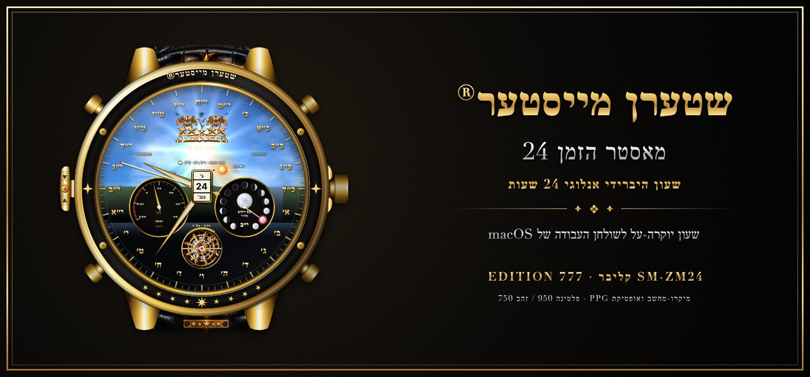
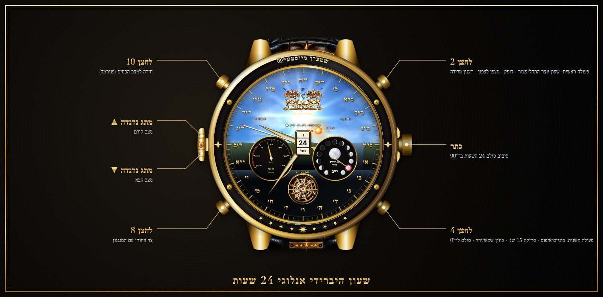
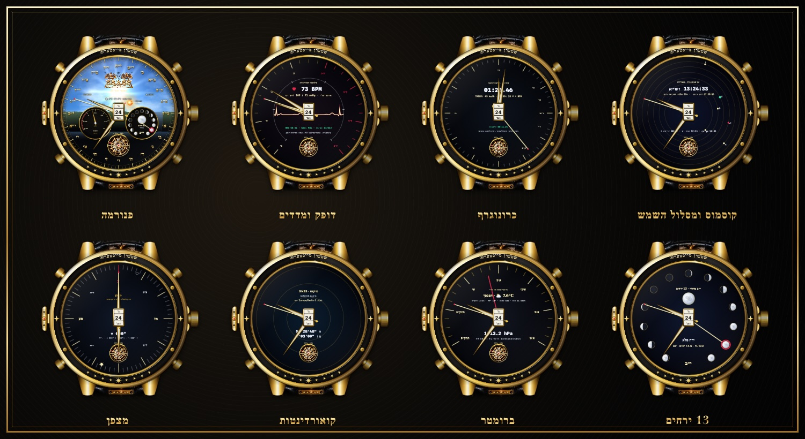
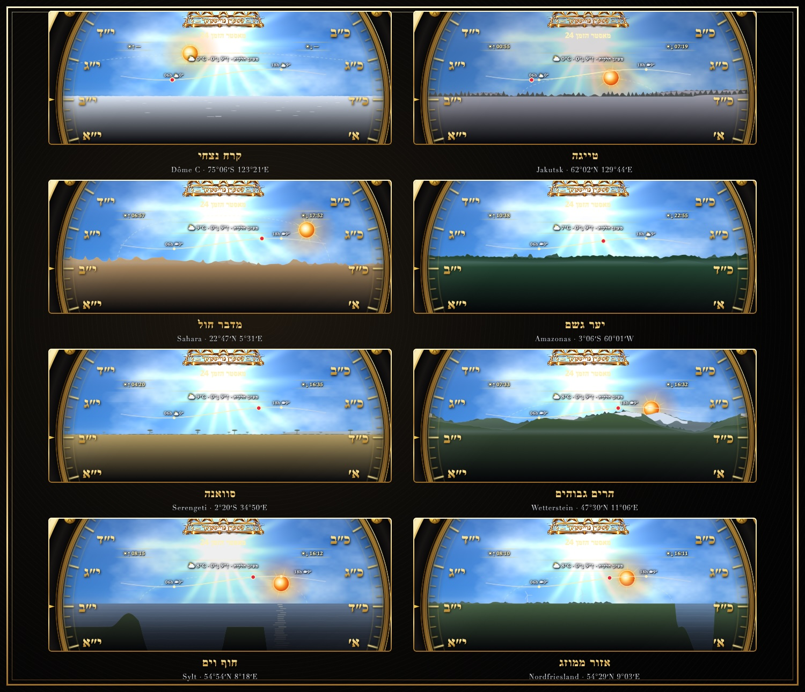
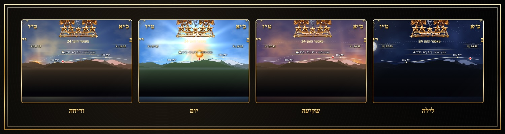
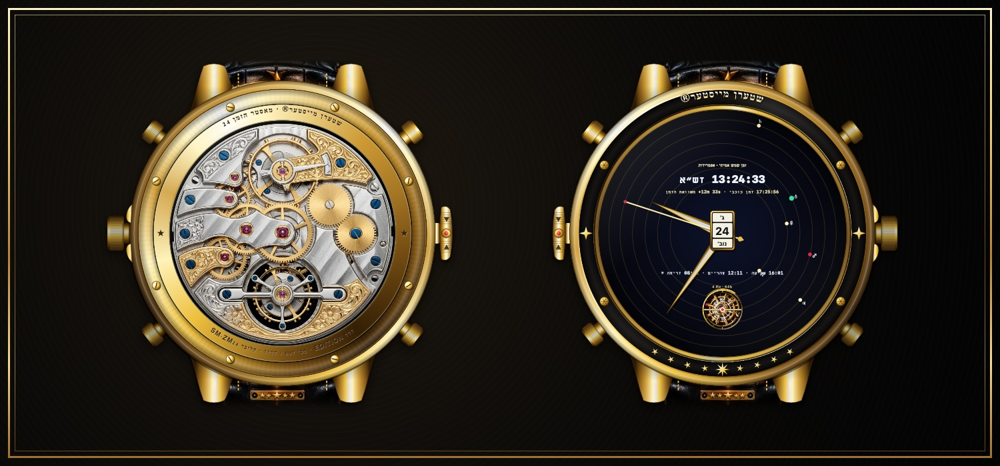

  

<a href="README.md">🇩🇪 Deutsch</a> &nbsp;·&nbsp; <a href="README.en.md">🇬🇧 English</a> &nbsp;·&nbsp; <a href="README.fr.md">🇫🇷 Français</a> &nbsp;·&nbsp; <a href="README.ru.md">🇷🇺 Русский</a> &nbsp;·&nbsp; <a href="README.zh.md">🇨🇳 中文</a> &nbsp;·&nbsp; <a href="README.ar.md">🇦🇪 العربية</a> &nbsp;·&nbsp; <b>🇮🇱 עברית</b> &nbsp;·&nbsp; <a href="README.yi.md">📜 Yiddish</a> &nbsp;·&nbsp; <a href="README.nl.md">🇳🇱 Nederlands</a>

<h1 align="center">✦ שטערן מייסטער® מאסטר הזמן 24 ✦</h1>
<h3 align="center"><i>שעון היברידי אנלוגי 24 שעות</i> · שעון יוקרה-על לשולחן העבודה של macOS</h3>

  
  
  
  

<b>יותר מזמן. יקום על שולחנך.</b> יוקרת-על · דיוק · מסורת · עתיד

## ✦ השעון ההיברידי האנלוגי של 24 שעות

**מאסטר הזמן 24** מאחד את שלוות מנגנון המחוגים הקלאסי עם תבונתו של מכשיר מדידה. לוח השעון מחלק את היממה ל־**24 שעות** – 18 למעלה, 6 למטה, צהריים משמאל, חצות מימין – ומאחוריו שמיים חיים: השמש והירח חוצים את האופק ב**מיקומם האמיתי**, והנוף שמתחת הוא הנוף של **המקום שלך**.

<table align="center">
<tr><td><b>✦ תיבה</b></td><td>זהב 18 קראט מלוטש, לוח אוניקס, שם המותג חרוט</td></tr>
<tr><td><b>✦ קליבר</b></td><td>SM-ZM24 · טורביון מעל 6 · 4 הרץ · מחוון רזרבת כוח</td></tr>
<tr><td><b>✦ הפעלה</b></td><td>כתר, ארבעה לחצנים ומתג נדנדה</td></tr>
<tr><td><b>✦ מהדורות</b></td><td>9 שפות עם ספרות, סמלים וחריטות משלהן</td></tr>
<tr><td><b>✦ מערכת</b></td><td>macOS 14 Sonoma ומעלה · Apple Silicon ו־Intel</td></tr>
</table>

## ✦ הפעלה – ניווט משמאל, פעולה מימין

לכל רכיב הפעלה תפקיד אחד בלבד. הצד השמאלי מוביל בין מצבי השעון, הצד הימני פועל במצב שנבחר.

| רכיב | תפקיד |
|:--|:--|
| **▲ ▼ מתג נדנדה · 9** | המצב הקודם או הבא – שמונה הסיבוכים במעגל |
| **לחצן · 10** | חזרה למצב הבסיס (פנורמה) |
| **לחצן · 8** | צד אחורי עם המנגנון |
| **כתר · 3** | סיבוב סולם 24 השעות ב־90° |
| **לחצן · 2** | פעולה ראשית: שעון עצר התחל/עצור · דופק · מצפן לצפון · רענון מדידה |
| **לחצן · 4** | פעולה משנית: ביניים/איפוס · סריקה 15 שנ׳ · כיוון שמש/ירח · סולם ל־0° |

## ✦ שמונה סיבוכים

| | |
|:--|:--|
| **1 · פנורמה** | שמי 24 שעות עם שמש, ירח, מזג אוויר, ברומטר, תצוגת 13 ירחים וטורביון. |
| **2 · דופק ומדדים** | פולסומטר, לחץ דם, HRV, ‏SpO₂ ועקומת דופק חיה; מדידת דופק בהקשה. |
| **3 · שעון עצר** | רטרפנט עד 1/100 שנייה עם זמני ביניים, טכימטר ופולסומטר. |
| **4 · קוסמוס ושמש** | זמן שמש אמיתי, משוואת הזמן, זמן כוכבי ותנועת כוכבי הלכת. |
| **5 · מצפן** | המחט נעה ביציבות לצפון ומתנדנדת בריסון בשינוי כיוון; כיוון השמש והירח. |
| **6 · קואורדינטות** | קו רוחב וקו אורך במעלות, דקות ושניות, גובה ומקור המיקום. |
| **7 · ברומטר** | לחץ אוויר 960–1080 הקטופסקל עם מזג אוויר, טמפרטורה, לחות ורוח. |
| **8 · 13 ירחים** | מחזור הירח של השנה עם מופע, הארה וגיל הירח. |

## ✦ הנוף של המקום שלך

במקום פנורמת הרים מצוירת, האופק מציג את **פני השטח האמיתיים** סביבך: נתוני גובה במרחק 2, 5, 12 ו־30 ק״מ ב־24 כיוונים, הים משירות המיקום של Apple או MapKit, ואזור האקלים לפי קפן־גייגר משלוש שנות נתונים. בכל מקום על פני כדור הארץ מופיע הנוף המתאים – מ**הקרח הנצחי** דרך הטונדרה, הטייגה, המדבר והסוואנה ועד **יער הגשם**, עם ים, קרח ים ושלג מעל קו השלג.

## ✦ שמש וירח בזמן אמת

השמש והירח עומדים במיקומם המחושב בשמיים ונעים בקשתם במהירות טבעית. זמני הזריחה והשקיעה מדויקים לדקה; יום קוטבי ולילה קוטבי מזוהים. השמיים עוקבים אחר גובה השמש האמיתי – משחר דרך היום אל הדמדומים והלילה.

## ✦ צד אחורי וקוסמוס

לחצן 8 חושף את המנגנון: פלטינה 950 וזהב 750 עם אבני אודם וברגים כחולים. מצב קוסמוס מציג זמן שמש אמיתי, משוואת הזמן, זמן כוכבי ותנועת כוכבי הלכת.

## ✦ תשע מהדורות

כל מהדורה נושאת את שם המותג שלה חרוט על שפת התיבה ומדברת בשפתה עד הפרט האחרון – לוח, ספרות, סולמות, תפריטים וחריטות.

| מהדורה | שם המותג | ספרות |
|:--|:--|:--|
| 🇩🇪 Deutsch | **SternenMeister®** · Zeitmeister 24 | 1 – 24 |
| 🇬🇧 English | **StarMaster®** · TimeMaster 24 | 1 – 24 |
| 🇫🇷 Français | **Maître des Étoiles®** · Maître du Temps 24 | 1 – 24 |
| 🇷🇺 Русский | **Звёздный Мастер®** · Мастер Времени 24 | 1 – 24 |
| 🇨🇳 中文 | **大师®** · 时空大师 24 | 一 – 二十四 |
| 🇦🇪 العربية | **شاهد النجوم®** · سيد الوقت ٢٤ | ١ – ٢٤ |
| 🇮🇱 עברית | **שטערן מייסטער®** · מאסטר הזמן 24 | א׳ – כ״ד |
| 📜 Yiddish | **ShternMayster®** · Tseytmayster 24 | 1 – 24 |
| 🇳🇱 Nederlands | **SterrenMeester®** · Tijdmeester 24 | 1 – 24 |

## ✦ התקנה ועדכונים

1. הורידו את [`Zeitmeister24-Widget-macOS.zip`](https://github.com/SonnerStudio/SternenMeister-ZeitMeister24-Widget/releases/latest/download/Zeitmeister24-Widget-macOS.zip) ופתחו את הדחיסה.
2. גררו את `ZeitmeisterApp.app` לתיקייה **יישומים** ופתחו.
3. מרכז העדכונים (תפריט **Update**) בודק ב־GitHub מיד עם פתיחתו ומתקין גרסאות חדשות בלחיצה אחת.

> היישום חתום כרגע בחתימה זמנית. בפתיחה הראשונה macOS עשוי להציג הודעה: לחיצה ימנית על היישום ← **פתח**.

## ✦ מקורות נתונים ופרטיות

לצורך מזג אוויר, לחץ אוויר, מסלול השמש והירח והנוף, **המיקום המשוער** שלך נשלח אל [Open-Meteo](https://open-meteo.com) (מזג אוויר, מודל גובה, ארכיון אקלים) ואל שירות המיקום של Apple. macOS מבקש הרשאת מיקום; בלעדיה השעון פועל לפי אזור הזמן ומציג שטח פתוח.

## ✦ חדש בגרסה 2.8.0

- ✦ תיבה חדשה לגמרי ומצוירת עם חריטת שם המהדורה על השפה
- ✦ מתג נדנדה ב־9 והיגיון הפעלה חדש: ניווט משמאל, פעולה מימין
- ✦ לוח מתורגם במלואו בכל המצבים, ספרות מקוריות לעברית, לסינית ולערבית
- ✦ נוף לפי המיקום, מסלול אמיתי של השמש והירח, יום ולילה קוטביים
- ✦ המחוגים מתייצבים תוך 0.9 שנייה בכל החלפה ובכל סיבוב של 90°

© 2026 SonnerStudio · מנופקטורת שטערן מייסטער® · מהדורה 777 · כל הזכויות שמורות.

