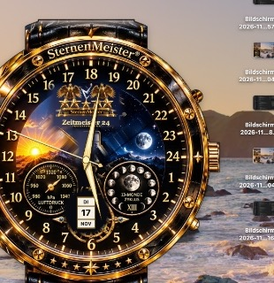
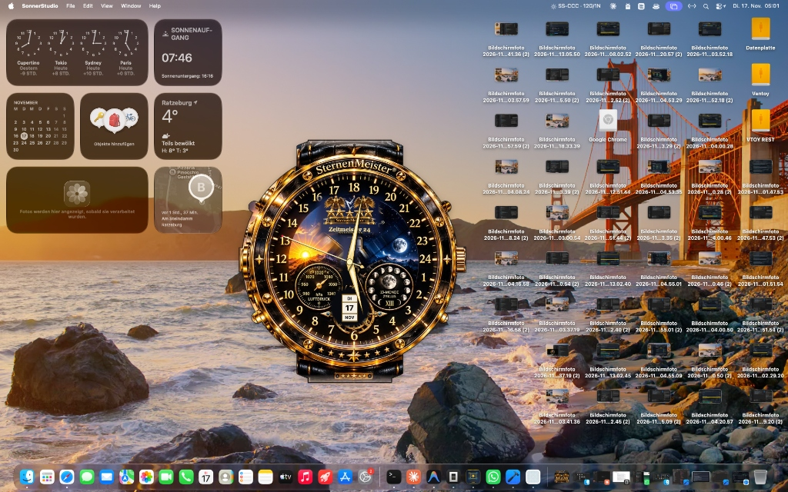

# SternenMeister Zeitmeister 24 · macOS Desktop-Widget

🇩🇪 **Deutsch** · [🇬🇧 Read in English](README.en.md)

---

  
   
  <em>SternenMeister Zeitmeister 24 · Edition 777 (Live macOS Desktop-Widget)</em>

## Übersicht
Das **SternenMeister Zeitmeister 24 Desktop-Widget** bringt die Hyper-Luxus-Armbanduhr der neuen Zeit als hochpräzise, frei bewegliche Simulation direkt auf Ihren macOS-Schreibtisch.

  

### Besonderheiten & Komplikationen:
- **Multifunktionsdisplay (5 Modi per Klick auf die Seitenknöpfe):** Dynamischer 24h-Tag/Nacht-Himmel (`Panorama`), Präzisions-`Kompass` (Grundstellung 6h/12h → Nordweisung), `Koordinaten` über macOS-Ortung (`CoreLocation`), `Barometer` mit 1-Wort-Wetterzustand (`STURM` / `REGEN` / `WECHSEL` / `SCHÖN` / `BESTÄNDIG`) und `13-Monde`-Astronomie.
- **Zentrales mechanisches Datumsgehäuse & rote Sekundenzeiger-Spitze:** Auf der Mittelachse montierte Datumsanzeige sowie 18k-Gelbgold-Zeiger mit Platineinlage und roter Spitze.
- **24-Stunden-Zifferblatt:** 1 Umlauf in 24 Stunden (18 Uhr oben = Sonnenuntergang / Goldene Stunde, 24 Uhr rechts = Mitternacht, 6 Uhr unten = Sonnenaufgang, 12 Uhr links = Mittag).
- **Drei Zeiger in 18k Gelbgold mit Platineinlage:** Stunden-, Minuten- und gleitender Sekundenzeiger sowie Zentralfutter in edlem Gelbgold mit handwerklich eingelegtem Platin.
- **Live-Barometer über macOS-Zeitzone:** Automatischer Echtzeit-Abruf des lokalen atmosphärischen Luftdrucks (hPa) via Open-Meteo Wetter-API basierend auf Ihrer in macOS aktiven Zeitzone.
- **Astronomische Mondphasenanzeige:** Exakte Berechnung von Mondphase, Beleuchtungsprozentsatz und aktueller 13-Monde-Zyklusziffer (`I` bis `XIII`).
- **Sammler-Etui (Edition 777 · Nr. 007 / 7777):** Umschaltbar per Rechtsklick zwischen hochglanzlackiertem Wurzelholz-Etui mit Klavierlack, Platin-Vril-Wappen und schwarzem Kalbsleder oder freigestellter Uhr.
- **Größen per Rechtsklick:** `2×2`, `3×3`, `4×4`, `5×5`, `6×6` · frei auf dem Schreibtisch verschiebbar.
- **GitHub-Update-Funktion:** Automatische Prüfung beim Start und alle 30 Minuten (`version.json` + GitHub Releases). Ist ein Update verfügbar, erscheint ein goldenes ⬇︎-Abzeichen am Widget und im Rechtsklick-Menü der Eintrag **„⬇︎ Update verfügbar: vX.Y.Z installieren“** mit Ein-Klick-Installation und automatischem Neustart.

---

## Installation

### Ein-Klick-Installation (Empfohlen)
1. Laden Sie die neueste Version von [GitHub Releases](https://github.com/SonnerStudio/SternenMeister-ZeitMeister24-Widget/releases/latest) herunter.
2. Entpacken Sie die ZIP-Datei und doppelklicken Sie auf `install-widget.command`.
3. Das Widget wird automatisch nach `/Applications` installiert und gestartet.

---

## Lizenz & Urheberrecht
Copyright © 2026 SonnerStudio. Alle Rechte vorbehalten.
Die Software ist urheberrechtlich geschützt. Der Quellcode ist vertraulich und nicht öffentlich zugänglich. Einzelheiten siehe [LICENSE.md](LICENSE.md).
