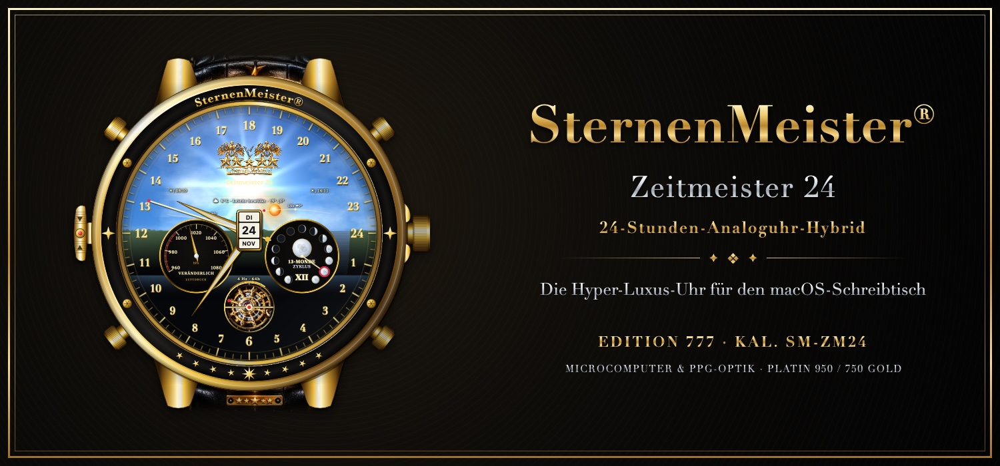
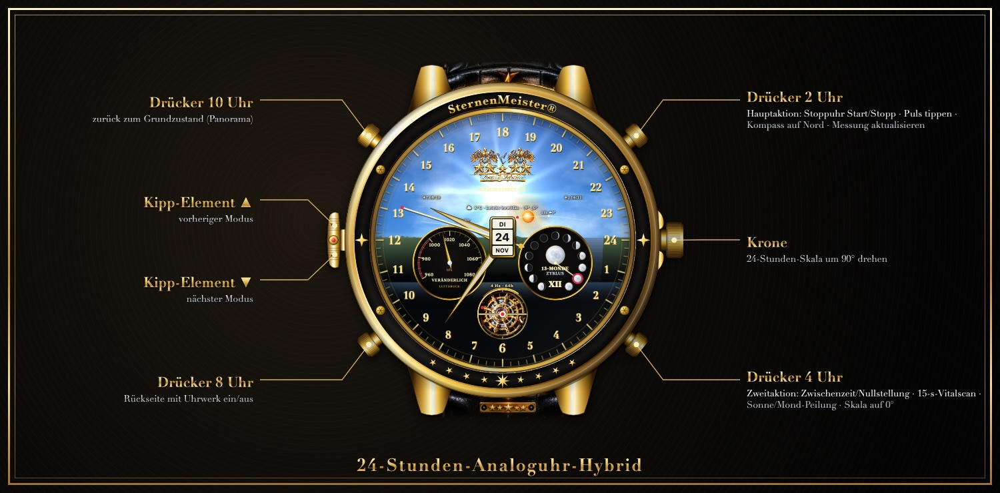
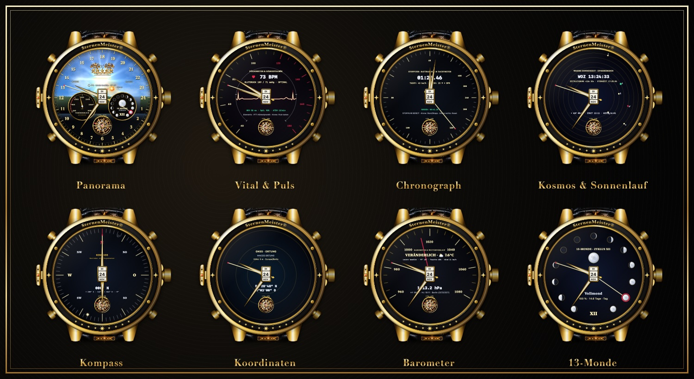
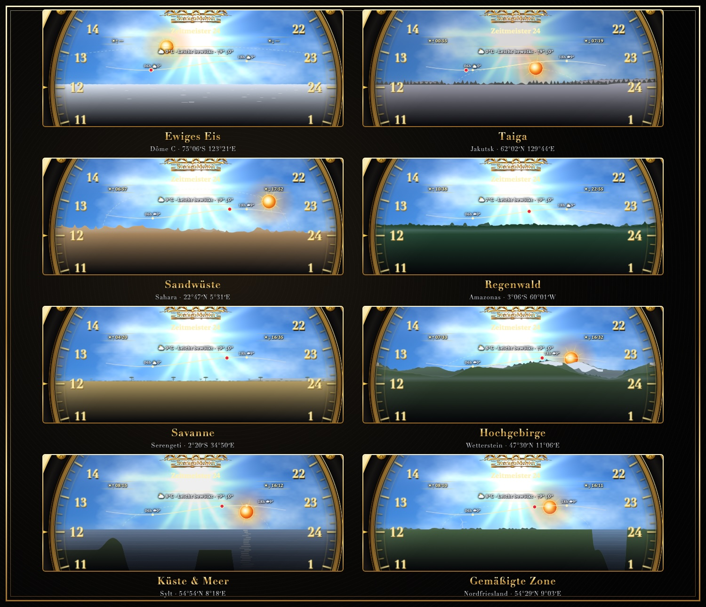
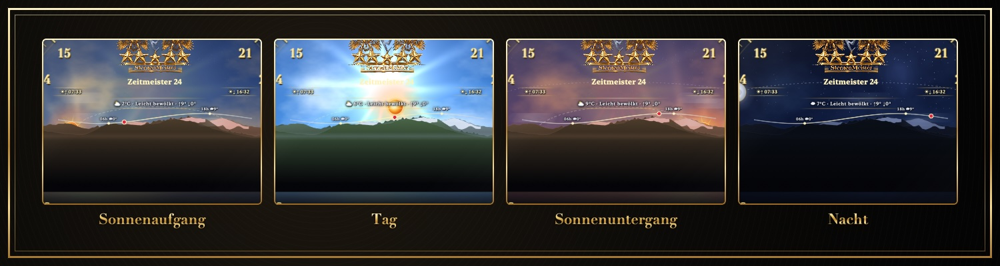
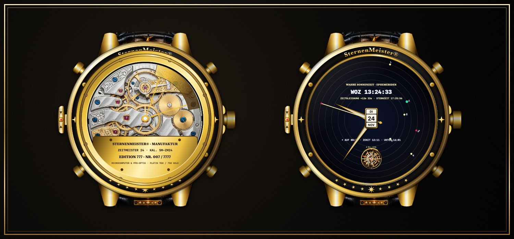

  

<b>🇩🇪 Deutsch</b> &nbsp;·&nbsp; <a href="README.en.md">🇬🇧 English</a> &nbsp;·&nbsp; <a href="README.fr.md">🇫🇷 Français</a> &nbsp;·&nbsp; <a href="README.ru.md">🇷🇺 Русский</a> &nbsp;·&nbsp; <a href="README.zh.md">🇨🇳 中文</a> &nbsp;·&nbsp; <a href="README.ar.md">🇦🇪 العربية</a> &nbsp;·&nbsp; <a href="README.he.md">🇮🇱 עברית</a> &nbsp;·&nbsp; <a href="README.yi.md">📜 Yiddish</a> &nbsp;·&nbsp; <a href="README.nl.md">🇳🇱 Nederlands</a>

<h1 align="center">✦ SternenMeister® Zeitmeister 24 ✦</h1>
<h3 align="center"><i>24-Stunden-Analoguhr-Hybrid</i> · Die Hyper-Luxus-Uhr für den macOS-Schreibtisch</h3>

  
  
  
  

<b>Mehr als Zeit. Ein Universum auf dem Schreibtisch.</b> HYPER-LUXUS · PRÄZISION · TRADITION · ZUKUNFT

## ✦ Der 24-Stunden-Analoguhr-Hybrid

Der **Zeitmeister 24** vereint die Ruhe eines klassischen Zeigerwerks mit der Intelligenz eines Instruments. Sein Zifferblatt teilt den Tag in **24 Stunden** – 18 Uhr steht oben, 6 Uhr unten, Mittag links, Mitternacht rechts – und zeigt dahinter einen lebendigen Himmel: Sonne und Mond ziehen an ihrer **echten Position** über den Horizont, und die Landschaft darunter ist die Landschaft **Ihres Standorts**.

<table align="center">
<tr><td><b>✦ Gehäuse</b></td><td>18 Karat Gold poliert, Onyx-Lünette, gravierter Markenname</td></tr>
<tr><td><b>✦ Kaliber</b></td><td>SM-ZM24 · Tourbillon über der 6 · 4 Hz · Gangreserve-Anzeige</td></tr>
<tr><td><b>✦ Bedienung</b></td><td>Krone, vier Drücker und ein Kipp-Element</td></tr>
<tr><td><b>✦ Editionen</b></td><td>9 Sprachen mit eigenen Ziffern, Wappen und Gravuren</td></tr>
<tr><td><b>✦ System</b></td><td>macOS 14 Sonoma oder neuer · Apple Silicon & Intel</td></tr>
</table>

## ✦ Bedienung – links navigieren, rechts handeln

Jedes Bedienelement hat genau eine Aufgabe. Die linke Seite führt durch die Uhr, die rechte Seite handelt im gewählten Modus.

| Element | Funktion |
|:--|:--|
| **▲ ▼ Kipp-Element · 9 Uhr** | Vorheriger bzw. nächster Modus – alle acht Komplikationen im Kreis |
| **Drücker · 10 Uhr** | Zurück zum Grundzustand (Panorama) |
| **Drücker · 8 Uhr** | Rückseite mit Uhrwerk ein/aus |
| **Krone · 3 Uhr** | 24-Stunden-Skala um 90° drehen |
| **Drücker · 2 Uhr** | Hauptaktion: Stoppuhr Start/Stopp · Puls tippen · Kompass auf Nord · Messung aktualisieren |
| **Drücker · 4 Uhr** | Zweitaktion: Zwischenzeit/Nullstellung · 15-s-Vitalscan · Sonne/Mond-Peilung · Skala auf 0° |

## ✦ Acht Komplikationen

| | |
|:--|:--|
| **1 · Panorama** | 24-Stunden-Himmel mit Sonne, Mond, Wetter, Barometer, 13-Monde-Anzeige und Tourbillon. |
| **2 · Vital & Puls** | Pulsometer, Blutdruck, HRV, SpO₂ und Live-Pulskurve; Puls per Tippen messen. |
| **3 · Stoppuhr** | Rattrapante auf 1/100 s mit Zwischenzeiten, Tachymeter und Pulsometer. |
| **4 · Kosmos & Sonne** | Wahre Sonnenzeit, Zeitgleichung, Sternzeit und Planetenlauf. |
| **5 · Kompass** | Nadel fährt starr auf Nord, schwingt gedämpft bei Richtungsänderung; Peilung von Sonne und Mond. |
| **6 · Koordinaten** | Breite und Länge in Grad, Minuten, Sekunden, Höhe und Ortsquelle. |
| **7 · Barometer** | Luftdruck 960–1080 hPa mit Wetterlage, Temperatur, Feuchte und Wind. |
| **8 · 13 Monde** | Der Mondzyklus des Jahres mit Phase, Beleuchtung und Mondalter. |

## ✦ Die Landschaft Ihres Standorts

Statt eines gemalten Bergpanoramas zeigt der Horizont das **echte Gelände** rund um den Standort: Höhendaten in 2, 5, 12 und 30 km Entfernung in 24 Richtungen, das Meer aus dem Apple-Ortsdienst bzw. MapKit und die Klimazone nach Köppen-Geiger aus drei Jahren Wetterdaten. So erscheint überall auf der Erde das Passende – vom **ewigen Eis** über Tundra, Taiga, Wüste und Savanne bis zum **Regenwald**, mit Meer, Meereis und Schnee über der Schneegrenze.

## ✦ Sonne und Mond in Echtzeit

Sonne und Mond stehen an ihrer berechneten Himmelsposition und ziehen in natürlicher Geschwindigkeit ihren Bogen. Auf- und Untergänge sind minutengenau, Polartag und Polarnacht werden erkannt. Der Himmel wechselt mit der echten Sonnenhöhe von Morgenrot über den Tag zur Abendröte und Nacht.

## ✦ Rückseite & Kosmos

Der Drücker bei 8 Uhr öffnet den Blick auf das Uhrwerk: Platin 950 und Gold 750 mit Rubinen und gebläuten Schrauben. Der Modus Kosmos zeigt wahre Sonnenzeit, Zeitgleichung, Sternzeit und den Lauf der Planeten. Das Werk lebt: Die Unruh schwingt mit 4 Hz über ihrer atmenden Breguet-Spirale, der Tourbillon-Käfig dreht in 60 Sekunden einmal, das Räderwerk greift ineinander. Ein **Peripherie-Rotor** aus 22-Karat-Gold mit Platin-950-Schwungmasse zieht die Uhr am Werkrand selbst auf, ohne den Blick zu verstellen. Über dem Mikrocomputer liegt eine gravierte Goldplatte mit Genfer Streifen, Platineinlagen und Saphirfenster. Beim Wenden zeigt die Uhr ihre volle Gehäusetiefe.

## ✦ Neun Editionen

Jede Edition trägt ihren Markennamen graviert auf dem Gehäuserand und spricht ihre Sprache bis ins Detail – Zifferblatt, Ziffern, Skalen, Menüs und Gravuren.

| Edition | Markenname | Ziffern |
|:--|:--|:--|
| 🇩🇪 Deutsch | **SternenMeister®** · Zeitmeister 24 | 1 – 24 |
| 🇬🇧 English | **StarMaster®** · TimeMaster 24 | 1 – 24 |
| 🇫🇷 Français | **Maître des Étoiles®** · Maître du Temps 24 | 1 – 24 |
| 🇷🇺 Русский | **Звёздный Мастер®** · Мастер Времени 24 | 1 – 24 |
| 🇨🇳 中文 | **大师®** · 时空大师 24 | 一 – 二十四 |
| 🇦🇪 العربية | **شاهد النجوم®** · سيد الوقت ٢٤ | ١ – ٢٤ |
| 🇮🇱 עברית | **שטערן מייסטער®** · מאסטר הזמן 24 | א׳ – כ״ד |
| 📜 Yiddish | **ShternMayster®** · Tseytmayster 24 | 1 – 24 |
| 🇳🇱 Nederlands | **SterrenMeester®** · Tijdmeester 24 | 1 – 24 |

## ✦ Installation & Updates

1. [`Zeitmeister24-Widget-macOS.zip`](https://github.com/SonnerStudio/SternenMeister-ZeitMeister24-Widget/releases/latest/download/Zeitmeister24-Widget-macOS.zip) herunterladen und entpacken.
2. `ZeitmeisterApp.app` in den Ordner **Programme** ziehen und öffnen.
3. Die Update-Zentrale (Menü **Update**) prüft beim Öffnen sofort bei GitHub und installiert neue Versionen mit einem Klick.

> Die App ist derzeit ad hoc signiert. Beim ersten Öffnen kann macOS einen Hinweis zeigen: Rechtsklick auf die App → **Öffnen**.

## ✦ Datenquellen & Datenschutz

Für Wetter, Luftdruck, Sonnen- und Mondlauf und die Landschaft wird der **ungefähre Standort** an [Open-Meteo](https://open-meteo.com) (Wetter, Höhenmodell, Klimaarchiv) und an den Apple-Ortsdienst übermittelt. macOS fragt dafür nach der Standortfreigabe. Ohne Freigabe arbeitet die Uhr mit der Zeitzone und zeigt offenes Land.

## ✦ Neu in Version 2.8.3

- ✦ Völlig neues, gezeichnetes Gehäuse mit Markengravur der Edition auf dem Rand
- ✦ Kipp-Element bei 9 Uhr und neue Bedienlogik: links navigieren, rechts handeln
- ✦ Zifferblatt in allen Modi vollständig übersetzt, eigene Zahlschriften für Hebräisch, Chinesisch und Arabisch
- ✦ Landschaft je Standort, echter Sonnen- und Mondlauf, Polartag und Polarnacht
- ✦ Zeiger nehmen bei jedem Wechsel und jeder 90°-Drehung in 0,9 s ihre Stellung ein

© 2026 SonnerStudio · SternenMeister® Manufaktur · Edition 777 · Alle Rechte vorbehalten.

