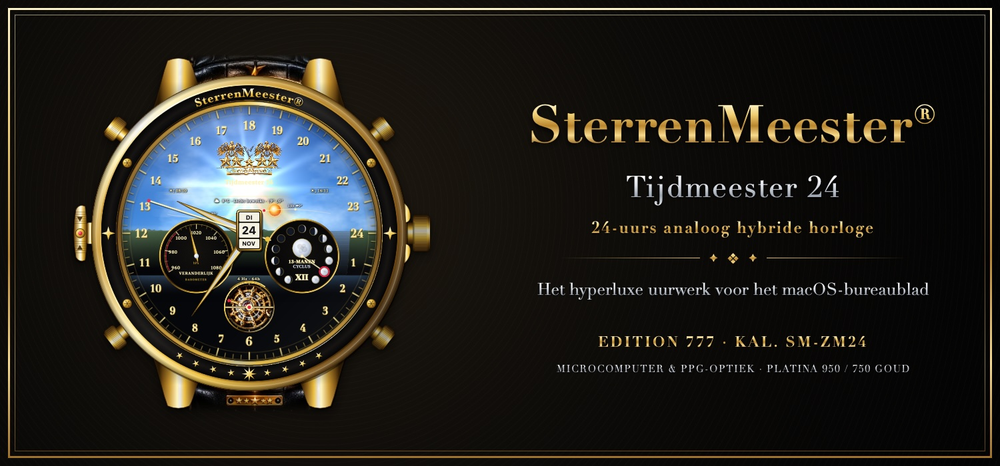
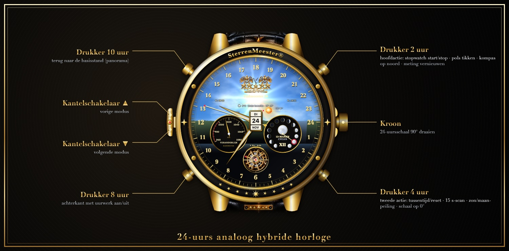
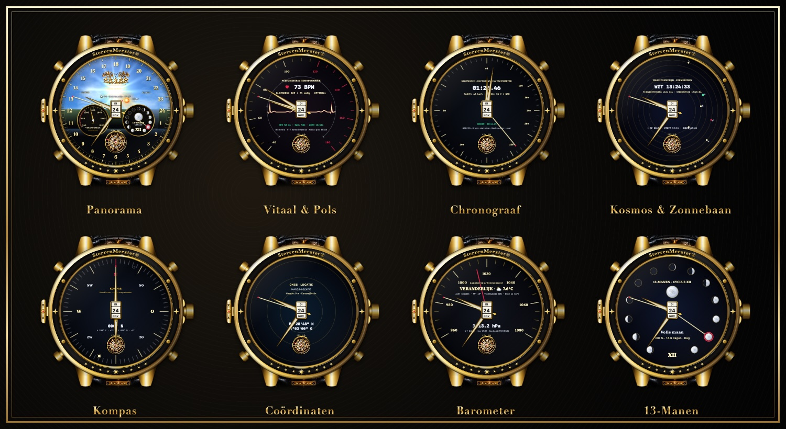
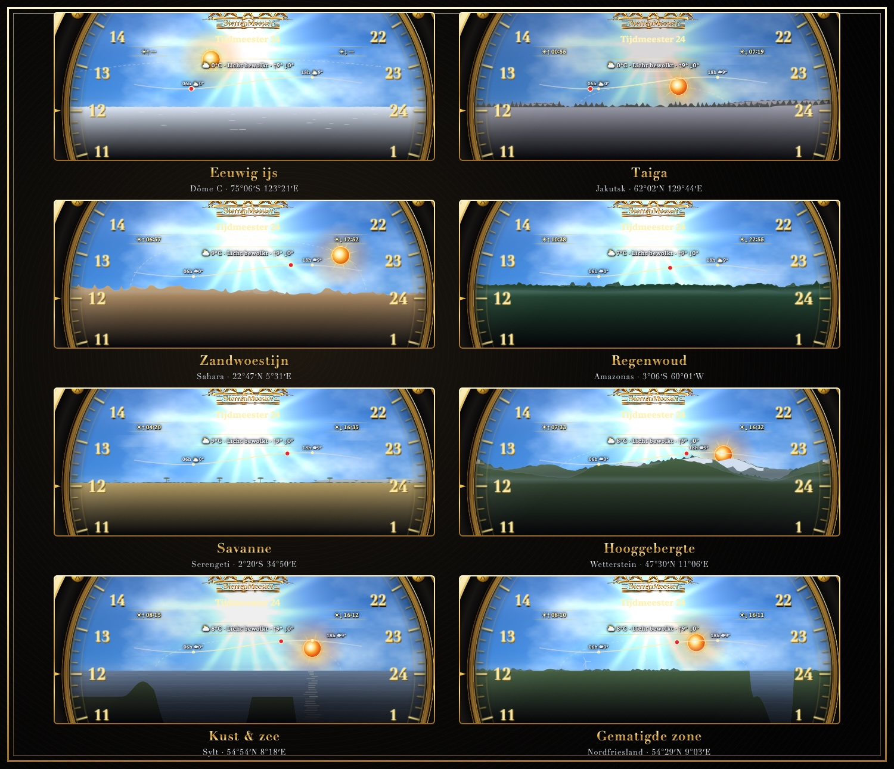
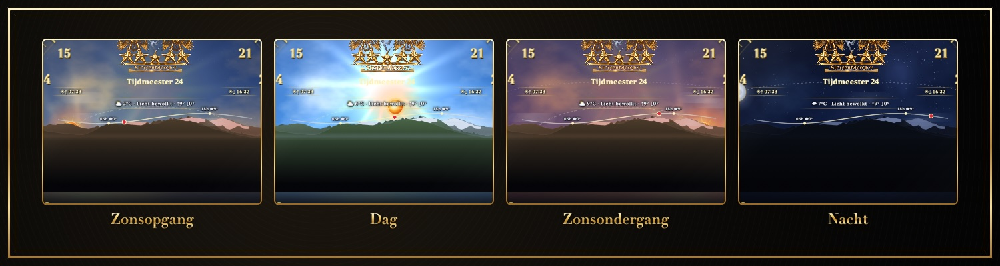
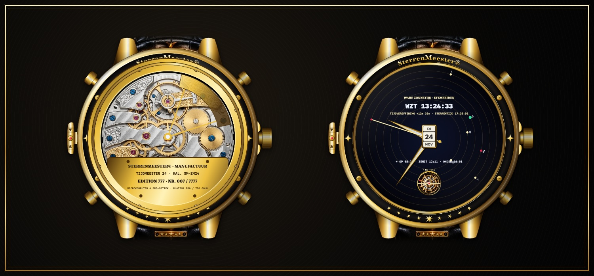

  

<a href="README.md">🇩🇪 Deutsch</a> &nbsp;·&nbsp; <a href="README.en.md">🇬🇧 English</a> &nbsp;·&nbsp; <a href="README.fr.md">🇫🇷 Français</a> &nbsp;·&nbsp; <a href="README.ru.md">🇷🇺 Русский</a> &nbsp;·&nbsp; <a href="README.zh.md">🇨🇳 中文</a> &nbsp;·&nbsp; <a href="README.ar.md">🇦🇪 العربية</a> &nbsp;·&nbsp; <a href="README.he.md">🇮🇱 עברית</a> &nbsp;·&nbsp; <a href="README.yi.md">📜 Yiddish</a> &nbsp;·&nbsp; <b>🇳🇱 Nederlands</b>

<h1 align="center">✦ SterrenMeester® Tijdmeester 24 ✦</h1>
<h3 align="center"><i>24-uurs analoog hybride horloge</i> · Het hyperluxe uurwerk voor het macOS-bureaublad</h3>

  
  
  
  

<b>Meer dan tijd. Een universum op je bureau.</b> HYPERLUXE · PRECISIE · TRADITIE · TOEKOMST

## ✦ Het 24-uurs analoge hybride horloge

De **Tijdmeester 24** verenigt de rust van een klassiek wijzeruurwerk met de intelligentie van een instrument. De wijzerplaat verdeelt de dag in **24 uur** – 18 uur boven, 6 uur onder, middag links, middernacht rechts – en daarachter een levende hemel: zon en maan trekken op hun **werkelijke positie** over de horizon, en het landschap eronder is het landschap van **jouw locatie**.

<table align="center">
<tr><td><b>✦ Kast</b></td><td>Gepolijst 18-karaats goud, onyx lunette, gegraveerde merknaam</td></tr>
<tr><td><b>✦ Kaliber</b></td><td>SM-ZM24 · tourbillon boven de 6 · 4 Hz · gangreserve-indicatie</td></tr>
<tr><td><b>✦ Bediening</b></td><td>Kroon, vier drukkers en een kantelschakelaar</td></tr>
<tr><td><b>✦ Edities</b></td><td>9 talen met eigen cijfers, wapens en gravures</td></tr>
<tr><td><b>✦ Systeem</b></td><td>macOS 14 Sonoma of nieuwer · Apple silicon & Intel</td></tr>
</table>

## ✦ Bediening – links navigeren, rechts handelen

Elk bedieningselement heeft precies één taak. De linkerkant leidt door het horloge, de rechterkant handelt in de gekozen modus.

| Element | Functie |
|:--|:--|
| **▲ ▼ Kantelschakelaar · 9 uur** | Vorige of volgende modus – alle acht complicaties in een kringloop |
| **Drukker · 10 uur** | Terug naar de basisstand (panorama) |
| **Drukker · 8 uur** | Achterkant met uurwerk aan/uit |
| **Kroon · 3 uur** | 24-uursschaal 90° draaien |
| **Drukker · 2 uur** | Hoofdactie: stopwatch start/stop · pols tikken · kompas op noord · meting vernieuwen |
| **Drukker · 4 uur** | Tweede actie: tussentijd/reset · 15 s-scan · zon/maan-peiling · schaal op 0° |

## ✦ Acht complicaties

| | |
|:--|:--|
| **1 · Panorama** | 24-uurshemel met zon, maan, weer, barometer, 13-manenweergave en tourbillon. |
| **2 · Vitaal & pols** | Pulsometer, bloeddruk, HRV, SpO₂ en live polscurve; pols meten door te tikken. |
| **3 · Stopwatch** | Rattrapante tot 1/100 s met tussentijden, tachymeter en pulsometer. |
| **4 · Kosmos & zon** | Ware zonnetijd, tijdvereffening, sterrentijd en de loop van de planeten. |
| **5 · Kompas** | De naald gaat strak naar noord en slingert gedempt bij een richtingsverandering; peiling van zon en maan. |
| **6 · Coördinaten** | Breedte en lengte in graden, minuten en seconden, hoogte en locatiebron. |
| **7 · Barometer** | Luchtdruk 960–1080 hPa met weer, temperatuur, vochtigheid en wind. |
| **8 · 13 Manen** | De maancyclus van het jaar met fase, verlichting en maanleeftijd. |

## ✦ Het landschap van jouw locatie

In plaats van een geschilderd bergpanorama toont de horizon het **echte terrein** rondom je: hoogtegegevens op 2, 5, 12 en 30 km in 24 richtingen, de zee uit de locatiedienst van Apple of MapKit, en de klimaatzone volgens Köppen-Geiger uit drie jaar weerdata. Overal op aarde verschijnt het juiste beeld – van **eeuwig ijs** via toendra, taiga, woestijn en savanne tot het **regenwoud**, met zee, zee-ijs en sneeuw boven de sneeuwgrens.

## ✦ Zon en maan in realtime

Zon en maan staan op hun berekende plek aan de hemel en trekken hun boog met natuurlijke snelheid. Op- en ondergang zijn tot op de minuut nauwkeurig; pooldag en poolnacht worden herkend. De hemel volgt de werkelijke zonnestand van dageraad via dag naar schemering en nacht.

## ✦ Achterkant & kosmos

De drukker bij 8 uur toont het uurwerk: platina 950 en goud 750 met robijnen en gebruineerde schroeven. De kosmosmodus toont ware zonnetijd, tijdvereffening, sterrentijd en de loop van de planeten. Het uurwerk leeft: de balans slingert met 4 Hz boven zijn ademende Breguet-spiraal, de tourbillonkooi draait in 60 seconden één keer rond en het raderwerk grijpt in elkaar. Een **perifere rotor** van 22-karaats goud met een massa van platina 950 windt het horloge aan de rand van het uurwerk zelf op, zonder het zicht te belemmeren. Een gegraveerde gouden plaat met Côtes de Genève, platina-inlegwerk en een saffiervenster bedekt de microcomputer. Bij het omdraaien toont het horloge zijn volle kastdikte.

## ✦ Negen edities

Elke editie draagt haar merknaam gegraveerd op de kastrand en spreekt haar taal tot in het kleinste detail – wijzerplaat, cijfers, schalen, menu’s en gravures.

| Editie | Merknaam | Cijfers |
|:--|:--|:--|
| 🇩🇪 Deutsch | **SternenMeister®** · Zeitmeister 24 | 1 – 24 |
| 🇬🇧 English | **StarMaster®** · TimeMaster 24 | 1 – 24 |
| 🇫🇷 Français | **Maître des Étoiles®** · Maître du Temps 24 | 1 – 24 |
| 🇷🇺 Русский | **Звёздный Мастер®** · Мастер Времени 24 | 1 – 24 |
| 🇨🇳 中文 | **大师®** · 时空大师 24 | 一 – 二十四 |
| 🇦🇪 العربية | **شاهد النجوم®** · سيد الوقت ٢٤ | ١ – ٢٤ |
| 🇮🇱 עברית | **שטערן מייסטער®** · מאסטר הזמן 24 | א׳ – כ״ד |
| 📜 Yiddish | **ShternMayster®** · Tseytmayster 24 | 1 – 24 |
| 🇳🇱 Nederlands | **SterrenMeester®** · Tijdmeester 24 | 1 – 24 |

## ✦ Installatie & updates

1. Download [`Zeitmeister24-Widget-macOS.zip`](https://github.com/SonnerStudio/SternenMeister-ZeitMeister24-Widget/releases/latest/download/Zeitmeister24-Widget-macOS.zip) en pak het uit.
2. Sleep `ZeitmeisterApp.app` naar **Programma’s** en open het.
3. Het updatecentrum (menu **Update**) controleert GitHub zodra het opent en installeert nieuwe versies met één klik.

> De app is momenteel ad hoc ondertekend. Bij de eerste start kan macOS een melding tonen: rechtsklik op de app → **Open**.

## ✦ Gegevensbronnen & privacy

Voor weer, luchtdruk, de baan van zon en maan en het landschap wordt je **globale locatie** gestuurd naar [Open-Meteo](https://open-meteo.com) (weer, hoogtemodel, klimaatarchief) en naar de locatiedienst van Apple. macOS vraagt om locatietoegang; zonder toegang werkt het horloge met de tijdzone en toont het open land.

## ✦ Nieuw in versie 2.8.5

- ✦ Volledig nieuwe, getekende kast met de merknaam van de editie gegraveerd op de rand
- ✦ Kantelschakelaar bij 9 uur en nieuwe bedieningslogica: links navigeren, rechts handelen
- ✦ Wijzerplaat in alle modi volledig vertaald, eigen cijferschriften voor Hebreeuws, Chinees en Arabisch
- ✦ Landschap per locatie, echte baan van zon en maan, pooldag en poolnacht
- ✦ Wijzers staan bij elke wissel en elke draaiing van 90° binnen 0,9 s op hun plek

© 2026 SonnerStudio · SterrenMeester® Manufactuur · Editie 777 · Alle rechten voorbehouden.

