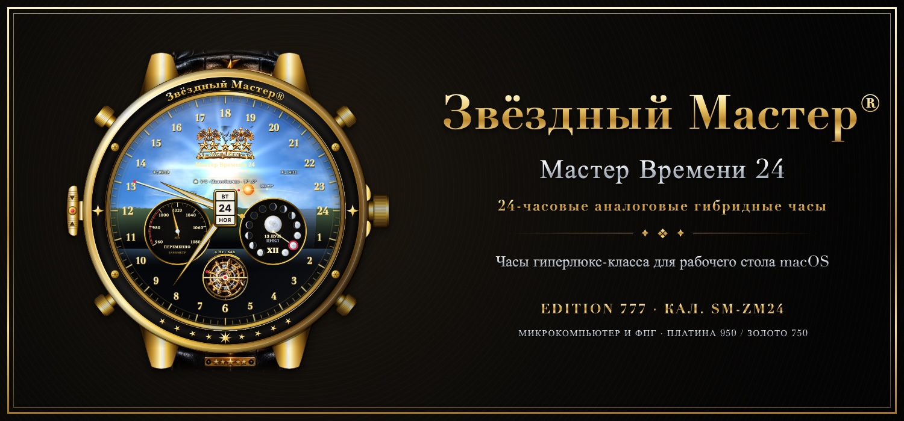
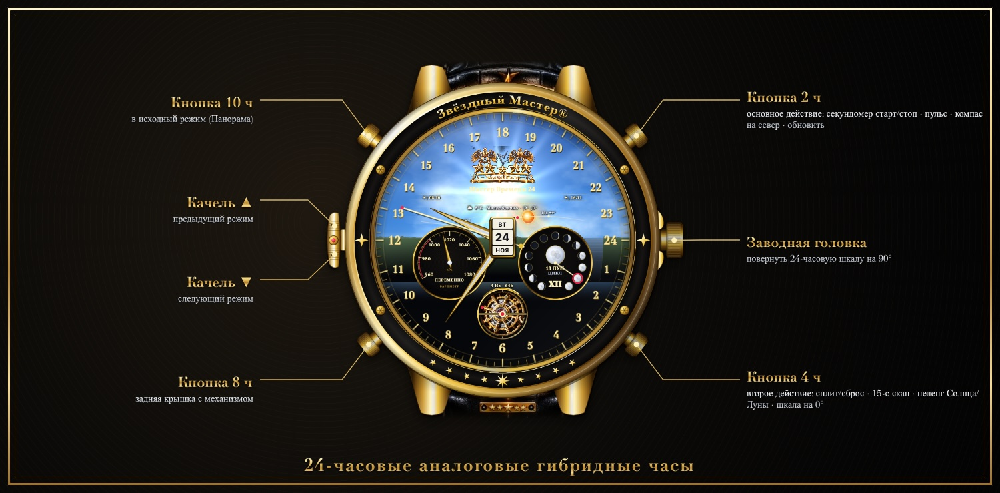
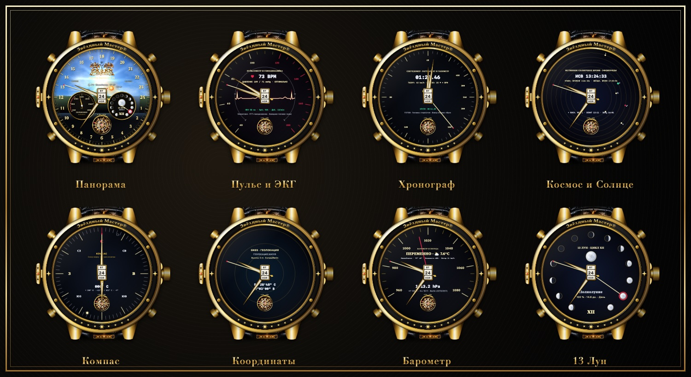
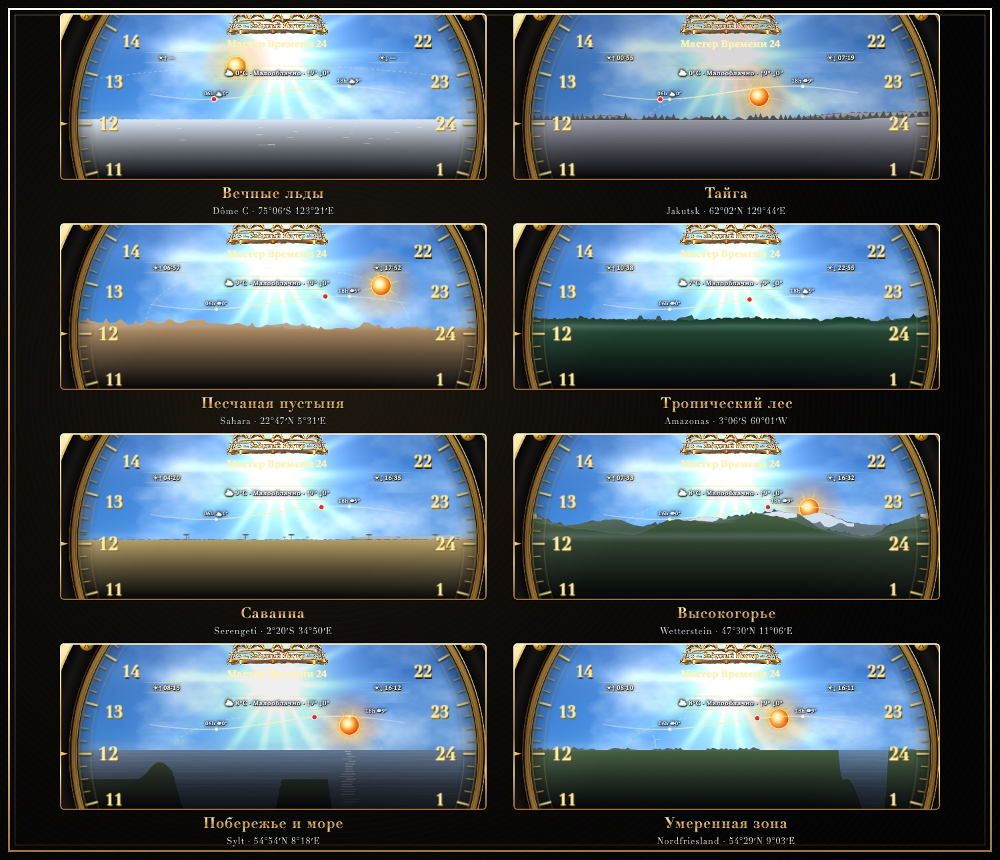
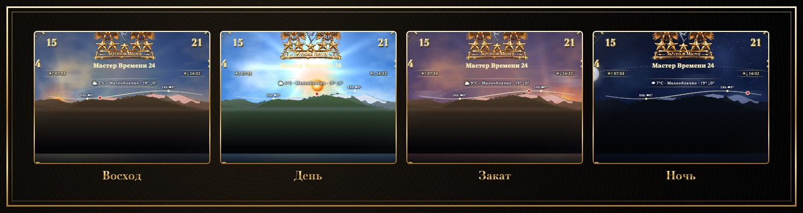
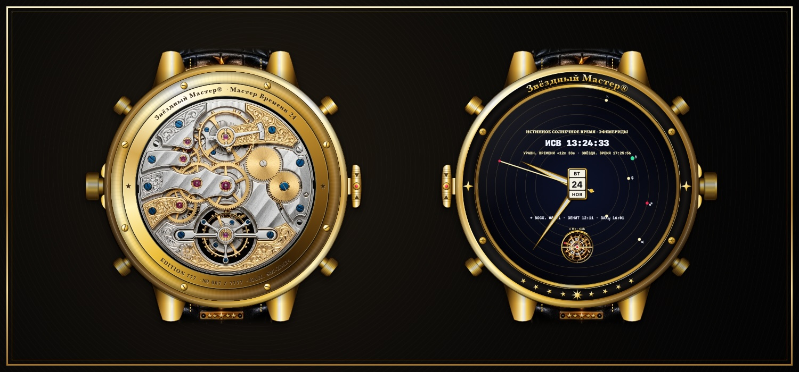

  

<a href="README.md">🇩🇪 Deutsch</a> &nbsp;·&nbsp; <a href="README.en.md">🇬🇧 English</a> &nbsp;·&nbsp; <a href="README.fr.md">🇫🇷 Français</a> &nbsp;·&nbsp; <b>🇷🇺 Русский</b> &nbsp;·&nbsp; <a href="README.zh.md">🇨🇳 中文</a> &nbsp;·&nbsp; <a href="README.ar.md">🇦🇪 العربية</a> &nbsp;·&nbsp; <a href="README.he.md">🇮🇱 עברית</a> &nbsp;·&nbsp; <a href="README.yi.md">📜 Yiddish</a> &nbsp;·&nbsp; <a href="README.nl.md">🇳🇱 Nederlands</a>

<h1 align="center">✦ Звёздный Мастер® Мастер Времени 24 ✦</h1>
<h3 align="center"><i>24-часовые аналоговые гибридные часы</i> · Часы гиперлюкс-класса для рабочего стола macOS</h3>

  
  
  
  

<b>Больше, чем время. Вселенная на вашем столе.</b> ГИПЕРЛЮКС · ТОЧНОСТЬ · ТРАДИЦИЯ · БУДУЩЕЕ

## ✦ 24-часовые аналоговые гибридные часы

**Мастер Времени 24** соединяет спокойствие классического стрелочного механизма с интеллектом измерительного прибора. Циферблат делит сутки на **24 часа** – 18:00 вверху, 06:00 внизу, полдень слева, полночь справа – а за ним живое небо: Солнце и Луна проходят над горизонтом в своём **истинном положении**, а пейзаж под ними – это пейзаж **вашего местоположения**.

<table align="center">
<tr><td><b>✦ Корпус</b></td><td>Полированное золото 18 карат, ониксовый безель, гравировка названия марки</td></tr>
<tr><td><b>✦ Калибр</b></td><td>SM-ZM24 · турбийон над цифрой 6 · 4 Гц · индикатор запаса хода</td></tr>
<tr><td><b>✦ Управление</b></td><td>Заводная головка, четыре кнопки и качель</td></tr>
<tr><td><b>✦ Издания</b></td><td>9 языков со своими цифрами, гербами и гравировками</td></tr>
<tr><td><b>✦ Система</b></td><td>macOS 14 Sonoma или новее · Apple Silicon и Intel</td></tr>
</table>

## ✦ Управление – слева навигация, справа действие

У каждого элемента ровно одна задача. Левая сторона ведёт по часам, правая действует в выбранном режиме.

| Элемент | Функция |
|:--|:--|
| **▲ ▼ Качель · 9 ч** | Предыдущий или следующий режим – все восемь усложнений по кругу |
| **Кнопка · 10 ч** | В исходный режим (Панорама) |
| **Кнопка · 8 ч** | Задняя крышка с механизмом |
| **Головка · 3 ч** | Повернуть 24-часовую шкалу на 90° |
| **Кнопка · 2 ч** | Основное действие: секундомер старт/стоп · пульс · компас на север · обновить |
| **Кнопка · 4 ч** | Второе действие: сплит/сброс · 15-с скан · пеленг Солнца/Луны · шкала на 0° |

## ✦ Восемь усложнений

| | |
|:--|:--|
| **1 · Панорама** | 24-часовое небо с Солнцем, Луной, погодой, барометром, индикацией 13 лун и турбийоном. |
| **2 · Пульс и показатели** | Пульсометр, давление, ВСР, SpO₂ и живая кривая пульса; измерение пульса касанием. |
| **3 · Секундомер** | Раттрапант до 1/100 с, промежуточное время, тахиметр и пульсометр. |
| **4 · Космос и Солнце** | Истинное солнечное время, уравнение времени, звёздное время и движение планет. |
| **5 · Компас** | Стрелка жёстко встаёт на север и с затуханием колеблется при смене направления; пеленг Солнца и Луны. |
| **6 · Координаты** | Широта и долгота в градусах, минутах и секундах, высота и источник местоположения. |
| **7 · Барометр** | Давление 960–1080 гПа с погодой, температурой, влажностью и ветром. |
| **8 · 13 Лун** | Лунный цикл года с фазой, освещённостью и возрастом Луны. |

## ✦ Пейзаж вашего местоположения

Вместо нарисованной горной панорамы горизонт показывает **реальный рельеф** вокруг вас: высоты на расстоянии 2, 5, 12 и 30 км в 24 направлениях, море по данным службы геолокации Apple или MapKit и климатическую зону по Кёппену–Гейгеру за три года наблюдений. В любой точке Земли появляется верная картина – от **вечных льдов** через тундру, тайгу, пустыню и саванну до **тропического леса**, с морем, морским льдом и снегом выше снеговой линии.

## ✦ Солнце и Луна в реальном времени

Солнце и Луна стоят на рассчитанном месте неба и проходят свою дугу с естественной скоростью. Восход и заход точны до минуты; полярный день и полярная ночь распознаются. Небо следует истинной высоте Солнца – от утренней зари через день к вечерней заре и ночи.

## ✦ Задняя крышка и космос

Кнопка на 8 ч открывает механизм: платина 950 и золото 750 с рубинами и воронёными винтами. Режим «Космос» показывает истинное солнечное время, уравнение времени, звёздное время и движение планет.

## ✦ Девять изданий

Каждое издание несёт своё название марки, выгравированное на ободе корпуса, и говорит на своём языке до мелочей – циферблат, цифры, шкалы, меню и гравировки.

| Издание | Название марки | Цифры |
|:--|:--|:--|
| 🇩🇪 Deutsch | **SternenMeister®** · Zeitmeister 24 | 1 – 24 |
| 🇬🇧 English | **StarMaster®** · TimeMaster 24 | 1 – 24 |
| 🇫🇷 Français | **Maître des Étoiles®** · Maître du Temps 24 | 1 – 24 |
| 🇷🇺 Русский | **Звёздный Мастер®** · Мастер Времени 24 | 1 – 24 |
| 🇨🇳 中文 | **大师®** · 时空大师 24 | 一 – 二十四 |
| 🇦🇪 العربية | **شاهد النجوم®** · سيد الوقت ٢٤ | ١ – ٢٤ |
| 🇮🇱 עברית | **שטערן מייסטער®** · מאסטר הזמן 24 | א׳ – כ״ד |
| 📜 Yiddish | **ShternMayster®** · Tseytmayster 24 | 1 – 24 |
| 🇳🇱 Nederlands | **SterrenMeester®** · Tijdmeester 24 | 1 – 24 |

## ✦ Установка и обновления

1. Скачайте [`Zeitmeister24-Widget-macOS.zip`](https://github.com/SonnerStudio/SternenMeister-ZeitMeister24-Widget/releases/latest/download/Zeitmeister24-Widget-macOS.zip) и распакуйте.
2. Перетащите `ZeitmeisterApp.app` в папку **Программы** и откройте.
3. Центр обновлений (меню **Update**) сразу проверяет GitHub и устанавливает новые версии одним щелчком.

> Приложение пока подписано ad hoc. При первом запуске macOS может показать предупреждение: правый щелчок по приложению → **Открыть**.

## ✦ Источники данных и конфиденциальность

Для погоды, давления, пути Солнца и Луны и пейзажа ваше **приблизительное местоположение** передаётся в [Open-Meteo](https://open-meteo.com) (погода, модель высот, климатический архив) и в службу геолокации Apple. macOS запрашивает доступ к геолокации. Без него часы используют часовой пояс и показывают открытую равнину.

## ✦ Новое в версии 2.8.0

- ✦ Полностью новый нарисованный корпус с гравировкой марки издания на ободе
- ✦ Качель на 9 ч и новая логика управления: слева навигация, справа действие
- ✦ Циферблат полностью переведён во всех режимах, собственные системы цифр для иврита, китайского и арабского
- ✦ Пейзаж по местоположению, истинный путь Солнца и Луны, полярный день и полярная ночь
- ✦ Стрелки встают на место за 0,9 с при каждой смене режима и повороте на 90°

© 2026 SonnerStudio · Мануфактура «Звёздный Мастер®» · Издание 777 · Все права защищены.

