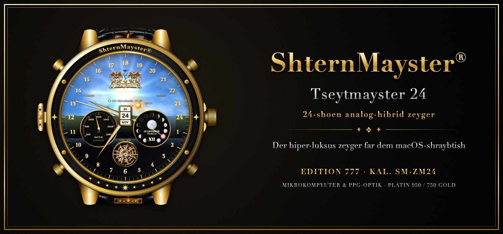
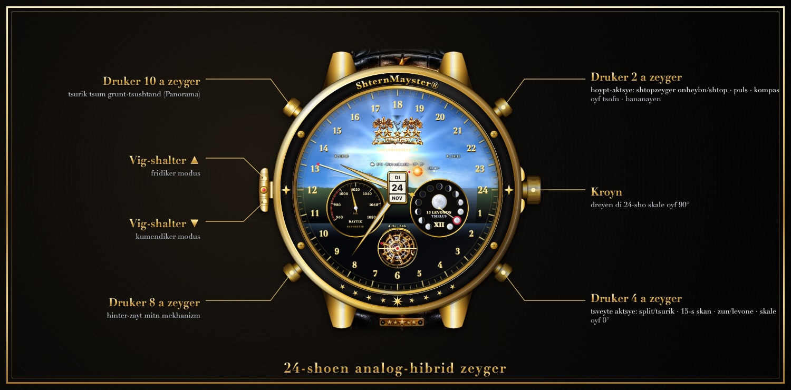
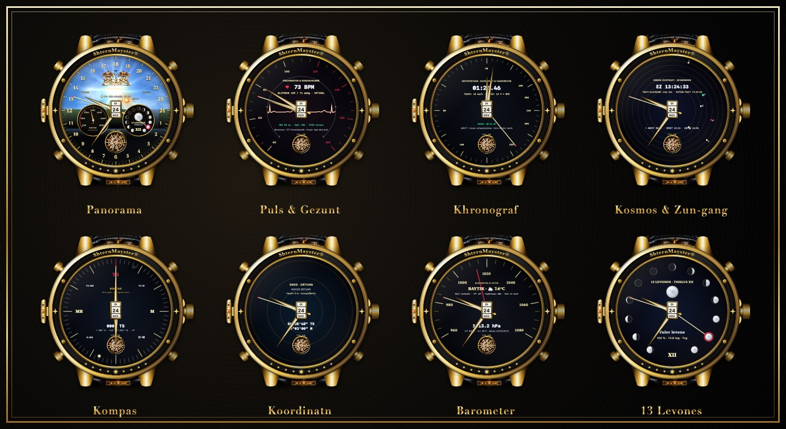
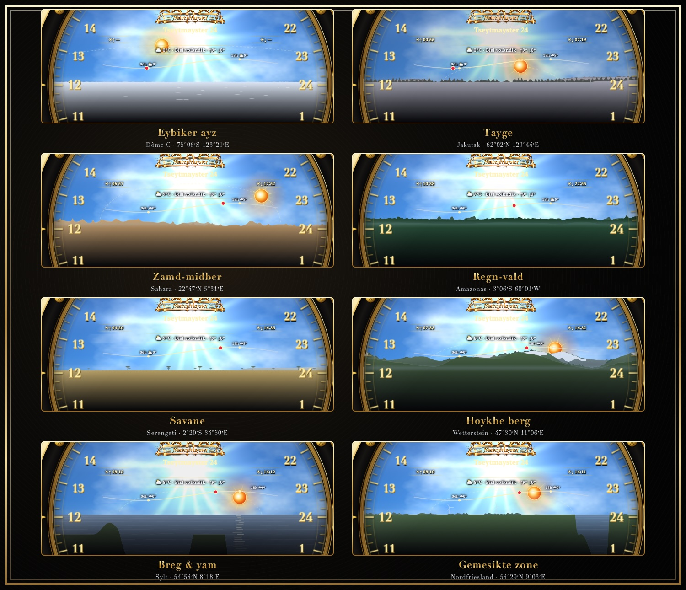
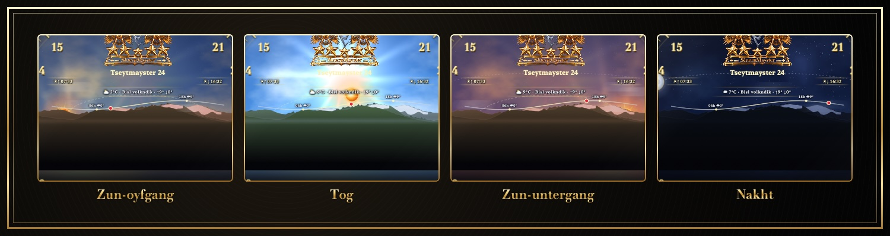
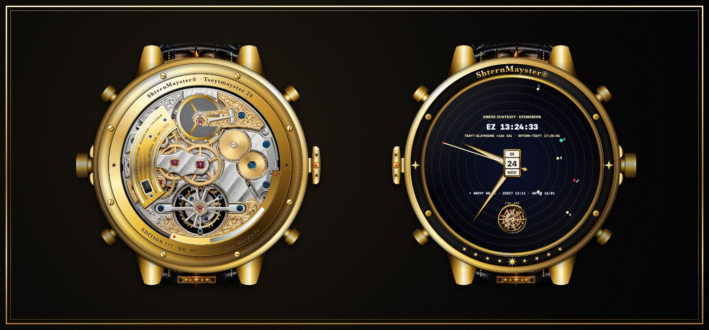
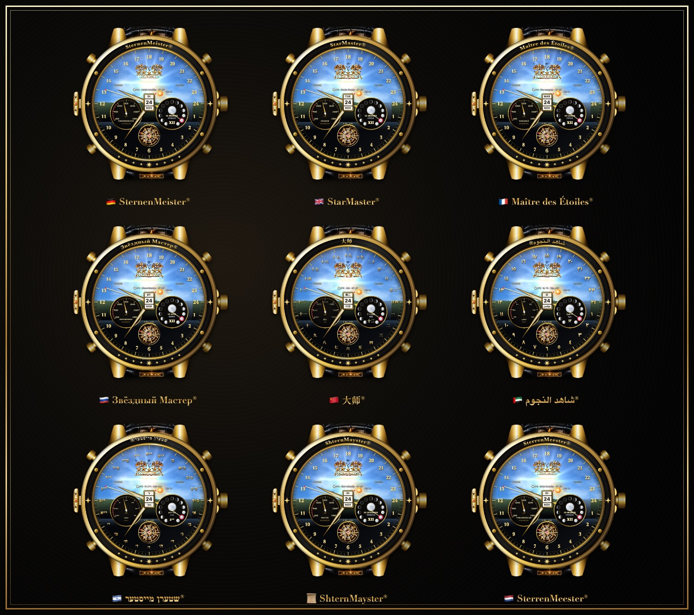

  

<a href="README.md">🇩🇪 Deutsch</a> &nbsp;·&nbsp; <a href="README.en.md">🇬🇧 English</a> &nbsp;·&nbsp; <a href="README.fr.md">🇫🇷 Français</a> &nbsp;·&nbsp; <a href="README.ru.md">🇷🇺 Русский</a> &nbsp;·&nbsp; <a href="README.zh.md">🇨🇳 中文</a> &nbsp;·&nbsp; <a href="README.ar.md">🇦🇪 العربية</a> &nbsp;·&nbsp; <a href="README.he.md">🇮🇱 עברית</a> &nbsp;·&nbsp; <b>📜 Yiddish</b> &nbsp;·&nbsp; <a href="README.nl.md">🇳🇱 Nederlands</a>

<h1 align="center">✦ ShternMayster® Tseytmayster 24 ✦</h1>
<h3 align="center"><i>24-shoen analog-hibrid zeyger</i> · Der hiper-luksus zeyger far dem macOS-shraybtish</h3>

  
  
  
  

<b>Mer vi tsayt. An univers oyf dayn tish.</b> HIPER-LUKSUS · PRETSIZYE · TRADITSYE · TSUKUNFT

## ✦ Der 24-shoen analog-hibrid zeyger

Der **Tseytmayster 24** fareynikt di ru fun a klasishn tseyger-mekhanizm mit der klugshaft fun an instrument. Der tsiferblat teylt dem tog in **24 shoen** – 18 oybn, 6 untn, mitog links, halbe nakht rekhts – un hinter im a lebedike himl: di zun un di levone geyen iber dem horizont oyf zeyer **emesn ort**, un di landshaft untn iz di landshaft fun **dayn ort**.

<table align="center">
<tr><td><b>✦ Kestl</b></td><td>Poliert 18-karat gold, oniks-ring, gegraveyrter mark-nomen</td></tr>
<tr><td><b>✦ Kaliber</b></td><td>SM-ZM24 · turbiyon iber 6 · 4 Hz · koyekh-reserve</td></tr>
<tr><td><b>✦ Bedinung</b></td><td>Kroyn, fir druker un a vig-shalter</td></tr>
<tr><td><b>✦ Oysgabes</b></td><td>9 shprakhn mit eygene tsifern, vopns un graveyrungen</td></tr>
<tr><td><b>✦ Sistem</b></td><td>macOS 14 Sonoma un hekher · Apple Silicon & Intel</td></tr>
</table>

## ✦ Bedinung – links navigirn, rekhts handlen

Yeder element hot genoy eyn oyfgabe. Di linke zayt firt durkh dem zeyger, di rekhte zayt handlt in dem oysgeveltn modus.

| Element | Funktsye |
|:--|:--|
| **▲ ▼ Vig-shalter · 9** | Fridiker oder kumendiker modus – ale akht komplikatsyes in a krayz |
| **Druker · 10** | Tsurik tsum grunt-tsushtand (Panorama) |
| **Druker · 8** | Hinter-zayt mitn mekhanizm |
| **Kroyn · 3** | Dreyen di 24-sho skale oyf 90° |
| **Druker · 2** | Hoypt-aktsye: shtopzeyger onheybn/shtop · puls · kompas oyf tsofn · bananayen |
| **Druker · 4** | Tsveyte aktsye: split/tsurik · 15-s skan · zun/levone · skale oyf 0° |

## ✦ Akht komplikatsyes

| | |
|:--|:--|
| **1 · Panorama** | 24-sho himl mit zun, levone, veter, barometer, 13-levones un turbiyon. |
| **2 · Puls & vital** | Pulsometer, blutdruk, HRV, SpO₂ un a lebedike puls-krive; mestn dem puls mit tapn. |
| **3 · Shtopzeyger** | Ratrapant biz 1/100 s mit tsvishntsaytn, takhimeter un pulsometer. |
| **4 · Kosmos & zun** | Emese zuntsayt, tsayt-glaykhung, shtern-tsayt un der gang fun di planetn. |
| **5 · Kompas** | Di nodl geyt shtayf oyf tsofn un shoklt zikh gedemft bay a rikhtung-baytung; zun un levone. |
| **6 · Koordinatn** | Breyt un leng in gradn, minutn un sekundes, hoykh un di kval fun ort. |
| **7 · Barometer** | Luftdruk 960–1080 hPa mit veter, temperatur, faykhtkayt un vint. |
| **8 · 13 Levones** | Der levone-tsikl fun yor mit faze, likht un elter fun der levone. |

## ✦ Di landshaft fun dayn ort

Anshtot a gemoltn barg-panorama vayzt der horizont dem **emesn terayn** arum dir: hoykhn oyf 2, 5, 12 un 30 km in 24 rikhtungen, dem yam fun Apple’s ort-dinst oder MapKit, un di klimat-zone loyt Köppen-Geiger fun dray yor veter-daten. Umetum oyf der erd kumt di rikhtike landshaft – fun **eybikn ayz** durkh tundre, tayge, midber un savane biz tsum **regn-vald**, mit yam, yam-ayz un shney iber der shney-grenets.

## ✦ Zun un levone in emeser tsayt

Di zun un di levone shteyen oyf zeyer oysgerekhntn ort un geyen zeyer boygn in natirlekher shnelkayt. Oyfgang un untergang zaynen genoy biz der minut; polar-tog un polar-nakht vern derkent.

## ✦ Hinter-zayt & kosmos

Der druker bay 8 efnt dem mekhanizm: platin 950 un gold 750 mit rubinen un bloye shroyfn. Der kosmos-modus vayzt emese zuntsayt, tsayt-glaykhung, shtern-tsayt un di planetn. Der mekhanizm lebt: di unru shoklt zikh mit 4 Hz iber ir otemdiker Breguet-shpiral, der turbiyon-shtayg dreyt zikh eyn mol in 60 sekundes. A **periferisher rotor** fun 22-karat gold mit a platin-950 vog tsit dem zeyger aleyn oyf. A gegraveyrte gold-plate mit platin-ayngelegtsn dekt dem mikrokompyuter. Bay dem iberdreyen vayzt der zeyger zayn fule tifkayt.

## ✦ Nayn oysgabes

Yede oysgabe trogt ir mark-nomen gegraveyrt oyfn rand fun kestl un redt ir shprakh biz tsum kleynstn detal.

| Oysgabe | Mark-nomen | Tsifern |
|:--|:--|:--|
| 🇩🇪 Deutsch | **SternenMeister®** · Zeitmeister 24 | 1 – 24 |
| 🇬🇧 English | **StarMaster®** · TimeMaster 24 | 1 – 24 |
| 🇫🇷 Français | **Maître des Étoiles®** · Maître du Temps 24 | 1 – 24 |
| 🇷🇺 Русский | **Звёздный Мастер®** · Мастер Времени 24 | 1 – 24 |
| 🇨🇳 中文 | **大师®** · 时空大师 24 | 一 – 二十四 |
| 🇦🇪 العربية | **شاهد النجوم®** · سيد الوقت ٢٤ | ١ – ٢٤ |
| 🇮🇱 עברית | **שטערן מייסטער®** · מאסטר הזמן 24 | א׳ – כ״ד |
| 📜 Yiddish | **ShternMayster®** · Tseytmayster 24 | 1 – 24 |
| 🇳🇱 Nederlands | **SterrenMeester®** · Tijdmeester 24 | 1 – 24 |

## ✦ Instalirung & bananayungen

1. Nemt arop [`Zeitmeister24-Widget-macOS.zip`](https://github.com/SonnerStudio/SternenMeister-ZeitMeister24-Widget/releases/latest/download/Zeitmeister24-Widget-macOS.zip) un pakt es oys.
2. Shlept `ZeitmeisterApp.app` in **Programen** un efnt es.
3. Der bananayung-tsenter (meniu **Update**) prift GitHub glaykh bay dem efenen un instalirt naye versyes mit eyn klik.

> Di program iz atsind ad-hoc untergeshribn. Bay dem ershtn efenen ken macOS vayzn a bamerkung: rekhter klik → **Efenen**.

## ✦ Daten-kvaln & privatkayt

Far veter, luftdruk, dem gang fun zun un levone un di landshaft vert dayn **untergefeyrer ort** geshikt tsu [Open-Meteo](https://open-meteo.com) un tsu Apple’s ort-dinst. macOS fregt far a derloybenish; on dem arbet der zeyger mit der tsaytzone.

## ✦ Nay in versye 2.8.2

- ✦ A gants nay gemoltn kestl mit dem mark-nomen fun der oysgabe gegraveyrt oyfn rand
- ✦ Vig-shalter bay 9 un a naye bedinung-logik: links navigirn, rekhts handlen
- ✦ Tsiferblat in ale modusn ingantsn ibergezetst
- ✦ Landshaft loyt dem ort, emeser gang fun zun un levone
- ✦ Di tseyger shteln zikh in 0,9 s bay yeder baytung

© 2026 SonnerStudio · ShternMayster® Manufaktur · Oysgabe 777 · Ale rekht farhitn.

