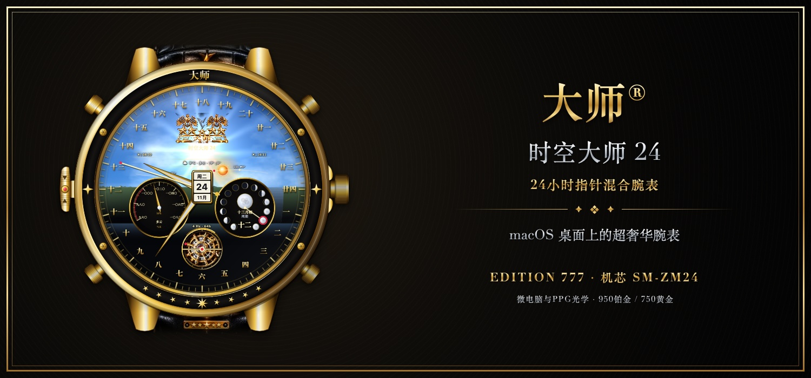
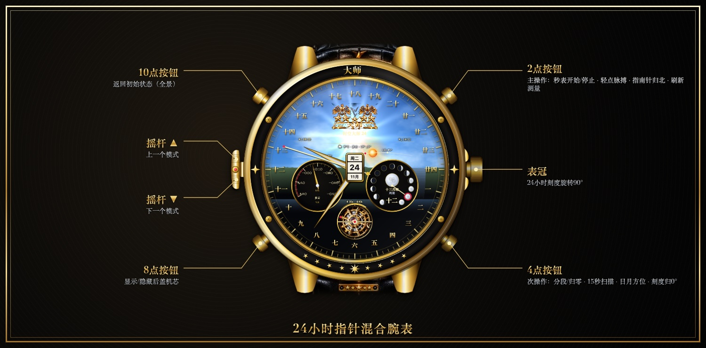
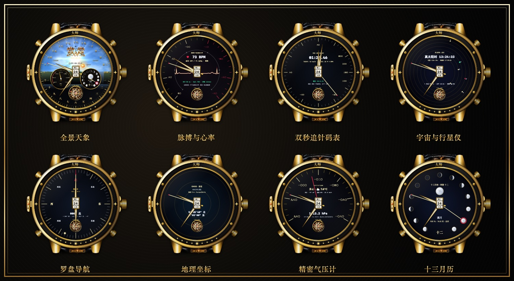
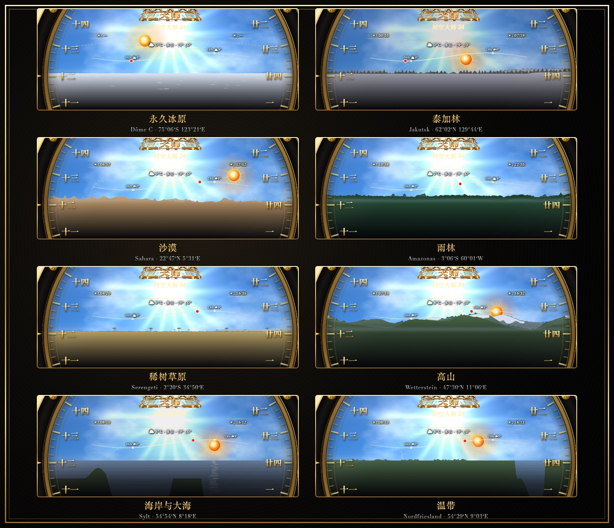
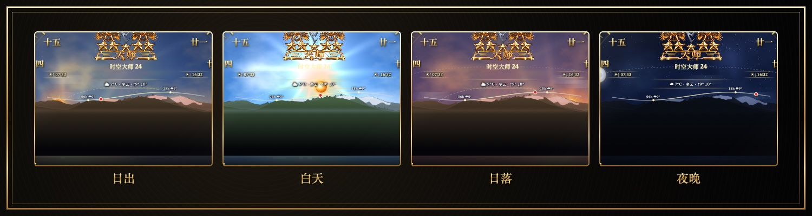
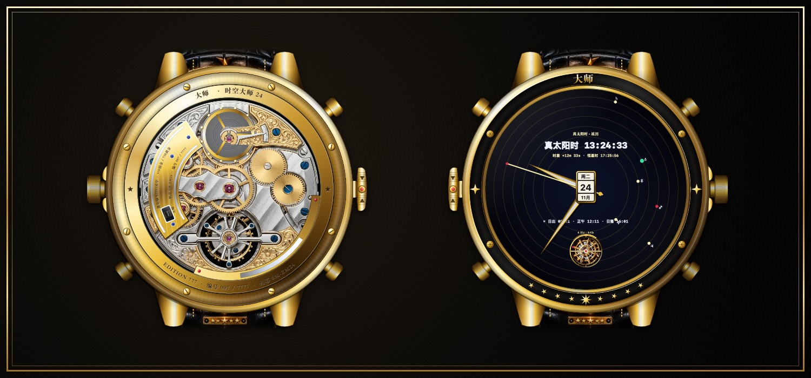

  

<a href="README.md">🇩🇪 Deutsch</a> &nbsp;·&nbsp; <a href="README.en.md">🇬🇧 English</a> &nbsp;·&nbsp; <a href="README.fr.md">🇫🇷 Français</a> &nbsp;·&nbsp; <a href="README.ru.md">🇷🇺 Русский</a> &nbsp;·&nbsp; <b>🇨🇳 中文</b> &nbsp;·&nbsp; <a href="README.ar.md">🇦🇪 العربية</a> &nbsp;·&nbsp; <a href="README.he.md">🇮🇱 עברית</a> &nbsp;·&nbsp; <a href="README.yi.md">📜 Yiddish</a> &nbsp;·&nbsp; <a href="README.nl.md">🇳🇱 Nederlands</a>

<h1 align="center">✦ 大师® 时空大师 24 ✦</h1>
<h3 align="center"><i>24小时指针混合腕表</i> · macOS 桌面上的超奢华腕表</h3>

  
  
  
  

<b>不止于时间。桌面上的一个宇宙。</b> 超奢华 · 精准 · 传承 · 未来

## ✦ 24小时指针混合腕表

**时空大师 24** 将经典指针机芯的从容与精密仪器的智慧融为一体。表盘将一天分为 **24 小时**——18 时在上，6 时在下，正午在左，午夜在右——其后是一片鲜活的天空：太阳与月亮在其**真实位置**越过地平线，下方的风景正是**您所在之地**的风景。

<table align="center">
<tr><td><b>✦ 表壳</b></td><td>抛光 18K 金、缟玛瑙表圈、镌刻品牌名</td></tr>
<tr><td><b>✦ 机芯</b></td><td>SM-ZM24 · 6 点上方陀飞轮 · 4 Hz · 动力储存指示</td></tr>
<tr><td><b>✦ 操作</b></td><td>表冠、四枚按钮与一枚摇杆</td></tr>
<tr><td><b>✦ 版本</b></td><td>9 种语言，各有专属数字、徽章与镌刻</td></tr>
<tr><td><b>✦ 系统</b></td><td>macOS 14 Sonoma 或更新 · Apple 芯片与 Intel</td></tr>
</table>

## ✦ 操作——左侧导航，右侧执行

每个操作件只承担一项任务。左侧引导浏览腕表，右侧在所选模式中执行操作。

| 操作件 | 功能 |
|:--|:--|
| **▲ ▼ 摇杆 · 9 点** | 上一个或下一个模式——八项复杂功能循环切换 |
| **按钮 · 10 点** | 返回初始状态（全景） |
| **按钮 · 8 点** | 显示/隐藏后盖机芯 |
| **表冠 · 3 点** | 24 小时刻度旋转 90° |
| **按钮 · 2 点** | 主操作：秒表开始/停止 · 轻点脉搏 · 指南针归北 · 刷新测量 |
| **按钮 · 4 点** | 次操作：分段/归零 · 15 秒扫描 · 日月方位 · 刻度归 0° |

## ✦ 八项复杂功能

| | |
|:--|:--|
| **1 · 全景天象** | 24 小时天空，含太阳、月亮、天气、气压计、十三月相显示与陀飞轮。 |
| **2 · 脉搏与体征** | 脉搏计、血压、心率变异、血氧与实时脉搏曲线；轻点即可测量脉搏。 |
| **3 · 秒表** | 精确到 1/100 秒的追针计时，含分段、测速与脉搏计。 |
| **4 · 宇宙与太阳** | 真太阳时、时差、恒星时与行星运行。 |
| **5 · 指南针** | 指针平稳指北，方向改变时阻尼摆动；显示太阳与月亮方位。 |
| **6 · 坐标** | 以度分秒显示纬度与经度，附海拔与定位来源。 |
| **7 · 气压计** | 960–1080 hPa 气压，含天气、温度、湿度与风速。 |
| **8 · 十三月** | 一年的月相周期，含月相、照度与月龄。 |

## ✦ 您所在之地的风景

地平线不再是绘制的山景，而是您周围的**真实地形**：24 个方向上 2、5、12、30 公里处的海拔数据，来自 Apple 定位服务或 MapKit 的海洋信息，以及依据三年气象数据得出的柯本气候带。无论身处地球何处，都会呈现相应的景色——从**永久冰原**到苔原、泰加林、沙漠与稀树草原，直至**热带雨林**，还有大海、海冰与雪线以上的积雪。

## ✦ 实时日月

太阳与月亮位于计算所得的天空位置，以自然速度划过天际。日出日落精确到分钟，可识别极昼与极夜。天空随真实太阳高度变化，从晨曦到白昼，再到晚霞与夜晚。

## ✦ 后盖与宇宙

8 点按钮可展示机芯：950 铂金与 750 黄金，镶嵌红宝石与烤蓝螺丝。宇宙模式显示真太阳时、时差、恒星时与行星运行。 机芯栩栩如生：摆轮在会呼吸的宝玑游丝上以 4 Hz 摆动，陀飞轮框架每 60 秒旋转一周，轮系相互啮合。22K 金配 950 铂金摆锤的**外缘自动陀**沿机芯边缘自动上链，不遮挡视线。微电脑上方覆有一块镌刻金板，饰以日内瓦波纹、铂金镶嵌与蓝宝石小窗。翻转时，腕表展现完整的表壳厚度。

## ✦ 九个版本

每个版本都在表壳边缘镌刻其品牌名，并在每个细节中使用本国语言——表盘、数字、刻度、菜单与镌刻。

| 版本 | 品牌名 | 数字 |
|:--|:--|:--|
| 🇩🇪 Deutsch | **SternenMeister®** · Zeitmeister 24 | 1 – 24 |
| 🇬🇧 English | **StarMaster®** · TimeMaster 24 | 1 – 24 |
| 🇫🇷 Français | **Maître des Étoiles®** · Maître du Temps 24 | 1 – 24 |
| 🇷🇺 Русский | **Звёздный Мастер®** · Мастер Времени 24 | 1 – 24 |
| 🇨🇳 中文 | **大师®** · 时空大师 24 | 一 – 二十四 |
| 🇦🇪 العربية | **شاهد النجوم®** · سيد الوقت ٢٤ | ١ – ٢٤ |
| 🇮🇱 עברית | **שטערן מייסטער®** · מאסטר הזמן 24 | א׳ – כ״ד |
| 📜 Yiddish | **ShternMayster®** · Tseytmayster 24 | 1 – 24 |
| 🇳🇱 Nederlands | **SterrenMeester®** · Tijdmeester 24 | 1 – 24 |

## ✦ 安装与更新

1. 下载 [`Zeitmeister24-Widget-macOS.zip`](https://github.com/SonnerStudio/SternenMeister-ZeitMeister24-Widget/releases/latest/download/Zeitmeister24-Widget-macOS.zip) 并解压。
2. 将 `ZeitmeisterApp.app` 拖入 **应用程序** 文件夹并打开。
3. 更新中心（菜单 **Update**）打开时即查询 GitHub，一键安装新版本。

> 本应用目前为临时签名。首次打开时 macOS 可能显示提示：右键点击应用 → **打开**。

## ✦ 数据来源与隐私

为获取天气、气压、日月轨迹与风景，您的**大致位置**会发送至 [Open-Meteo](https://open-meteo.com)（天气、海拔模型、气候档案）及 Apple 定位服务。macOS 会请求定位授权；若未授权，腕表将依据时区显示开阔原野。

## ✦ 2.8.2 版新内容

- ✦ 全新绘制的表壳，表圈镌刻各版本品牌名
- ✦ 9 点位置的摇杆与全新操作逻辑：左侧导航，右侧执行
- ✦ 所有模式下表盘完全翻译，希伯来文、中文与阿拉伯文使用本国数字
- ✦ 随所在地变化的风景、真实日月轨迹、极昼与极夜
- ✦ 每次切换与每次 90° 旋转，指针均在 0.9 秒内就位

© 2026 SonnerStudio · 大师® 制表工坊 · Edition 777 · 保留所有权利。

